# YOUNORA LUXURY FASHION — E-Commerce Platform
## Master Project Plan v3.0 (Final) — Architecture, Reselling, Phase-Wise Build Guide

| | |
|---|---|
| **Project** | Younora Luxury Fashion — own-brand storefront + CRM + reseller panel |
| **Stack** | MERN — MongoDB, Express 5, React (CRM) / Next.js (storefront), Node 20, **CommonJS** |
| **Version** | 3.0 — 6 Nov 2026 (supersedes v1.0 and v2.0) |
| **Build order** | Backend (fully tested) → CRM → Storefront (incl. Reseller panel) |
| **Working style** | One phase at a time. Agent describes the phase → owner approves → agent codes → agent writes sign-off → agent gives commit + tag → STOP |
| **Philosophy** | Simple application that works properly first. Advanced features come later (see §24). |

> **File location:** `docs/PLAN.md` (repo root). The Antigravity agent reads this file directly. The owner does **not** need to paste prompts per phase. The owner only says **"Start Phase <ID>"**.

---

## TABLE OF CONTENTS
0. Phase Progress Tracker
1. Overview, Goals, Roles
2. **Agent Operating Protocol (MANDATORY)**
3. Engineering Rules
4. Brand & Design System
5. System Architecture
6. Data Flow Diagrams
7. Database Design
8. Core Business Logic Specs
9. Reselling Module (full spec)
10. Manual Returns Register
11. Batch System & Batch Search
12. In-App Notification System
13. Bigship Integration
14. Payments (Razorpay + COD)
15. Folder Structure
16. API Surface
17. Backend Phase Plan (B0–B13)
18. Frontend Phase Plan (F0–F11)
19. Testing Strategy
20. Security Checklist
21. Deployment & Environments
22. Git Workflow, Commit & Tag Convention
23. Risks & Mitigations
24. Deferred Features / Roadmap
25. Decision Log & Open Questions
26. Appendix: Permissions, Enums, Sign-off Template

---

## 0. Phase Progress Tracker
*(The agent updates `docs/phases/PROGRESS.md` after every phase; this table is the master copy.)*

| Phase | Name | Status | Tag |
|---|---|---|---|
| B0 | Foundation | ✅ Done | v0.0.0 |
| B1 | Auth, Users, Roles | 🟡 In progress — Slice 1 done, **resume at Slice 2** | v0.1.0 |
| B2–B13 | see §17 | ⬜ Not started | — |
| F0–F11 | see §18 | ⬜ Not started | — |

---

## 1. Overview, Goals, Roles

### 1.1 Background
The owner sold garments on Meesho and suffered from unjustified returns. He now wants **his own platform** under the brand **Younora Luxury Fashion** with control over catalog, batches, orders, pricing, and a **reselling programme** (people share products and earn a margin). Returns are handled **manually** (phone/WhatsApp), not through the app.

### 1.2 Business goals
| # | Goal | How the platform supports it |
|---|---|---|
| G1 | Full catalog control | Variant products (color × size), per-variant price/stock, bulk import |
| G2 | Traceability | Unique **batch number** per lot, on invoice, **searchable in CRM and by customers** |
| G3 | Reliable fulfilment | Bigship integration with retry, label, tracking sync |
| G4 | Flexible payments | Razorpay + COD with admin toggle and rules |
| G5 | **Reselling income** | Resellers set a margin, share a link, earn into a wallet; separate Reselling Invoice |
| G6 | Return control without a return module | Manual Returns Register keeps stock, refunds, batch data and reseller earnings consistent |
| G7 | Trust | Verified-buyer reviews with admin moderation |
| G8 | Engagement | In-app notifications (bell + real-time), no SMS/WhatsApp cost |
| G9 | Premium brand | Luxury design system from the Younora logo |

### 1.3 Roles
| Role | Surface | Capabilities |
|---|---|---|
| Guest | Storefront | Browse, cart, batch search, open reseller share links, checkout `[CONFIRM guest checkout]` |
| Customer | Storefront | Shop, orders, wishlist, reviews, addresses |
| **Reseller** | Storefront "Reselling" area | A customer with `resellerStatus = APPROVED`. Create share links with margin, see own orders/earnings/wallet, request payout |
| Super Admin | CRM | Everything |
| Staff | CRM | Permission-based (see §26.1) |

### 1.4 Out of scope for v1
Native app, multi-vendor, multi-warehouse, multi-language, loyalty points, ERP sync, in-app return requests/exchange, risk scoring, Web Push (optional later phase), automatic payouts.

---

## 2. Agent Operating Protocol (MANDATORY)

> **The Antigravity agent must follow this section exactly, every phase, without being re-prompted.** If this file and a chat message conflict, stop and ask the owner. `PROJECT_RULES.md` must contain a copy of §2 and §3.

### 2.1 Trigger
The owner starts work by saying **"Start Phase <ID>"** (for example "Start Phase B2"). The agent then works only on that phase, using the phase's section in §17 or §18 as the full specification.

### 2.2 The six-step loop (never skip, never reorder)

**STEP 1 — Read.** Read `docs/PLAN.md` (this file), `PROJECT_RULES.md`, `docs/phases/PROGRESS.md` and the previous phase's sign-off. Confirm the previous phase is signed off. If not, say so and stop.

**STEP 2 — Phase Briefing (NO CODE).** Reply with a briefing in this exact structure:
1. **Phase goal** (2–3 sentences, plain language)
2. **What will be built** (modules, models, endpoints/screens)
3. **File list** (every file to create or change, by path)
4. **New packages** (name, version, reason; "none" if none)
5. **Environment variables** added
6. **Test plan** (the specific tests, mapped to the phase's test checklist)
7. **Manual checks** the owner should do (Postman or UI steps)
8. **Risks / assumptions / open questions** (anything unclear in the plan)
9. **Explicitly out of scope** for this phase
10. **Slices** (the internal build order, 3–6 slices)

**STEP 3 — Ask permission.** End the briefing with exactly: **"Shall I start writing code for Phase <ID>? (yes / change plan)"** and **STOP**. Write no code until the owner answers yes.

**STEP 4 — Implement.** After "yes", build the **entire phase** slice by slice without asking again, unless blocked by a genuine ambiguity or a missing credential. After each slice, run `npm run lint` and `npm test`, fix failures, then continue. Rules during implementation:
- Follow §3 Engineering Rules strictly. Touch only files that belong to this phase.
- Do not add libraries beyond the briefing without asking.
- Never run git commands, never commit, never tag, never push. The owner does that.
- If the plan needs a deviation, stop, explain, and wait for the owner's answer.
- Reference code from the old Green Tree backend (folder `reference/`) is **read-only**. Read it for ideas; rewrite to our rules. Never copy `.env` values.

**STEP 5 — Verify and sign off.** When all slices are done:
1. Run the full lint and test suites and show the real output summary.
2. Create `docs/phases/<ID>-signoff.md` using the template in §26.3, filled in honestly (tests run, manual checks for the owner, known issues, deferred items).
3. Update `docs/phases/PROGRESS.md`, the module README files, and the Postman/OpenAPI files for new endpoints.
4. Update this plan's Decision Log (§25) if any decision changed.

**STEP 6 — Hand over, then STOP.** Final message must contain, in this order:
1. **Summary** (what was built, test counts, anything deferred)
2. **Owner manual checklist** (short list)
3. **Commit message** and **tag command**, together, in one copy-paste block (format in §22.3)
4. The line: **"Phase <ID> is complete. Waiting for your 'Start Phase <next ID>'."**

Then do nothing further. The agent never starts the next phase on its own.

### 2.3 Hard guardrails
- One phase per session. Never begin work for a later phase "while here".
- Never invent third-party API details (Bigship, Razorpay). Read their official docs at the start of the relevant phase, save sample payloads under `docs/api/samples/`, and mark anything unverified `[VERIFY]` in the briefing.
- Never trust client input for price, margin, total, stock, discount, role or user id.
- Never print secrets. Never log tokens, OTPs, passwords or payout details.
- If tests fail and cannot be fixed within the phase, report plainly. Do not mark the phase done.

---

## 3. Engineering Rules
*(Copy into `PROJECT_RULES.md`.)*

1. **Modular monolith**, modules under `src/modules/<name>/`, talking through service functions or the event bus, never through each other's models (read-only populate is allowed).
2. **Layering:** route → Zod validation → controller (thin) → service (all business logic) → model.
3. **CommonJS** (`require`/`module.exports`). Node 20, Express 5 (async errors forwarded natively).
4. **Validation:** Zod schemas live in each module's `<name>.validation.js`. Never trust client prices, margins, totals, stock, discounts, roles or user ids.
5. **Money:** integer **paise** everywhere. No floating-point money math. Convert only at UI edges.
6. **Response format** (always):
   ```json
   { "success": true, "message": "…", "data": {}, "meta": { "page": 1, "limit": 20, "total": 100 } }
   { "success": false, "message": "…", "code": "STOCK_UNAVAILABLE", "errors": [ { "field": "…", "message": "…" } ] }
   ```
7. **Errors:** `AppError(statusCode, code, message)` + one global error middleware. 401 = not authenticated, 403 = not permitted, 404, 409, 422 as appropriate. No stack traces to clients.
8. **Config:** all config via `config/env.js` (Zod-validated, fail fast). No `process.env` elsewhere.
9. **Logging:** `pino` only. No `console.log`. Never log secrets, tokens, OTPs, passwords, payout details.
10. **Transactions** for order placement, stock changes, refunds, wallet changes. **Idempotency** for payments, webhooks, shipment creation, refunds, wallet credits.
11. **Snapshots:** order lines store product name, SKU, color, size, base price, margin, final price, GST, batch number, image at purchase time.
12. **Soft delete** for catalog and customers. Ledgers (stock, wallet, audit) are **immutable**: corrections are new rows.
13. **Naming:** files `camelCase.js` with module suffixes (`order.service.js`), collections plural, constants `UPPER_SNAKE`, enums in `packages/shared-constants`.
14. **Tests:** every phase ships automated tests for its critical logic. A phase without passing tests is not done.
15. **Docs:** each module has a short `README.md` (purpose, endpoints, events). New endpoints go into the Postman/OpenAPI files.
16. No dead code, no commented-out blocks, no `console.log`, no secrets in git.
17. **Small, conventional commits** (see §22). The owner commits; the agent only proposes the message.

---

## 4. Brand & Design System

### 4.1 Logo mood
Gold elegant serif wordmark with calligraphic swashes, amber silk drape, stylised woman with wide-brim hat, on deep black/espresso silk. Mood: luxurious, feminine, warm, premium.

### 4.2 Colour tokens
| Token | Hex | Usage |
|---|---|---|
| `--ynr-onyx` | `#0B0705` | Primary dark background, footer, hero |
| `--ynr-espresso` | `#1A100B` | CRM sidebar/topbar, dark surfaces |
| `--ynr-cocoa` | `#2C1B11` | Elevated dark surfaces |
| `--ynr-gold-300` | `#F2CF85` | Highlights |
| `--ynr-gold-500` | `#D9A441` | **Primary accent**: buttons, links, borders |
| `--ynr-gold-700` | `#B07D2A` | Gold on light backgrounds, pressed states |
| `--ynr-amber-500` | `#E8731A` | Sale badges, CTA highlights |
| `--ynr-amber-700` | `#B8470A` | Amber pressed |
| `--ynr-ivory` | `#F8F1E4` | Light page background |
| `--ynr-cream` | `#EFE4D0` | Alternating sections |
| `--ynr-sand` | `#E7DCC8` | Borders on light |
| `--text-on-dark` / `--text-muted-on-dark` | `#F8F1E4` / `#BFAE98` | Text on dark |
| `--text-on-light` / `--text-muted-on-light` | `#1A100B` / `#6B5A4B` | Text on light |
| `--success` `--warning` `--danger` `--info` | `#2E7D4F` `#D98E04` `#B3261E` `#2F6F8F` | Semantic states |

Gradients: gold `135deg #F2CF85 → #D9A441 → #B07D2A`; silk `135deg #E8731A → #B8470A`; dark `180deg #1A100B → #0B0705`.

**Accessibility:** gold `#D9A441` fails contrast on ivory for small text; use gold-700 or onyx text on light. Verify WCAG AA (4.5:1).

### 4.3 Surfaces
| Surface | Theme |
|---|---|
| Storefront | Ivory content, onyx header/footer/hero, gold accents, amber sale badges |
| CRM | Espresso sidebar/topbar, ivory content, white cards, gold active states |
| Reseller panel | Same as storefront account area, with gold "earnings" accents |

### 4.4 Typography and UI tokens
- **Headings (storefront):** Cormorant Garamond (or Playfair Display). **Body/UI:** Inter or Jost. **CRM:** Inter. Tabular numerals for prices.
- Type scale (rem): 0.75 / 0.875 / 1 / 1.125 / 1.25 / 1.5 / 2 / 2.5 / 3.25.
- Radius: 4px inputs/buttons, 8px cards, 999px pills. Spacing grid 4px. Shadow `0 8px 30px rgba(26,16,11,0.12)`. Border 1px sand. Motion 200–300ms ease-out, respect `prefers-reduced-motion`.
- Buttons: primary = gold gradient + onyx text; secondary = outline; danger; ghost. Badges: sale = amber, new = gold outline, low stock = warning, out of stock = muted grey.
- Logo: get SVG from client. Provide full-colour (dark bg), mono gold, mono onyx, icon mark, favicon set, OG image.

---

## 5. System Architecture

### 5.1 High-level diagram
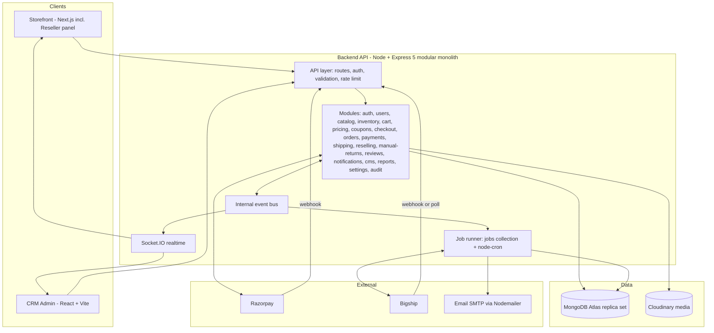

### 5.2 Technology decisions
| Layer | Choice | Reason |
|---|---|---|
| Runtime / framework | Node 20, Express 5, CommonJS | Matches old code, native async errors |
| Database | MongoDB Atlas + Mongoose 8 | Transactions need replica set |
| Validation | Zod per module | Fail-fast input checking |
| Auth | JWT access (15 min) + rotating refresh token (httpOnly cookie, hashed in DB) | Secure SPA auth |
| Passwords | bcryptjs, cost ≥ 12 | No native build on Windows |
| Background work | `jobs` collection + `node-cron` (1-minute poll) | No Redis in v1; interface allows BullMQ later |
| Realtime | Socket.IO | In-app bell, no paid service |
| Media | Cloudinary | Existing, transformations |
| Payments | Razorpay | Required |
| Shipping | Bigship through provider adapter | Required |
| Email | Nodemailer (SMTP) | Password reset, verification, invoices only |
| PDF | pdfkit | Invoices, packing slips |
| Excel | exceljs | Product import/export, stock receive |
| Logging | pino + pino-http | Structured |
| Security | helmet, cors whitelist, express-rate-limit, express-mongo-sanitize, hpp | Hardening |
| Tests | Jest, Supertest, mongodb-memory-server (replica set) | Fast isolated |
| CRM | React 18, Vite, React Router, TanStack Query, React Hook Form + Zod, TanStack Table, Tailwind, Recharts | Data-heavy admin |
| Storefront | Next.js App Router, TanStack Query, Tailwind | SEO + speed |
| API docs | OpenAPI + Postman | Frontend contract |

### 5.3 Environments
`local` → `staging` (client UAT; Razorpay test, Bigship sandbox) → `production`.

---

## 6. Data Flow Diagrams

### 6.1 Level 0 — Context
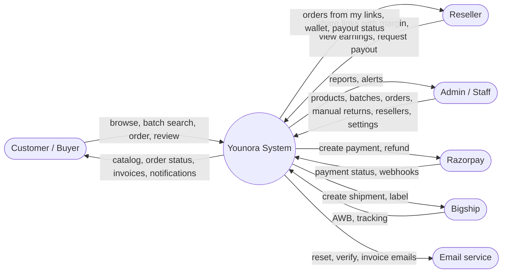

### 6.2 Level 1 — Main processes
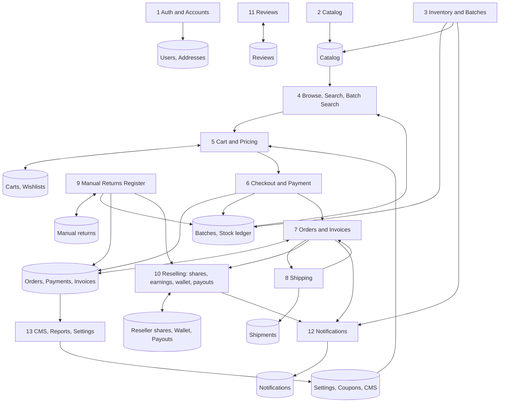

### 6.3 Level 2 — Checkout and payment (with reselling)
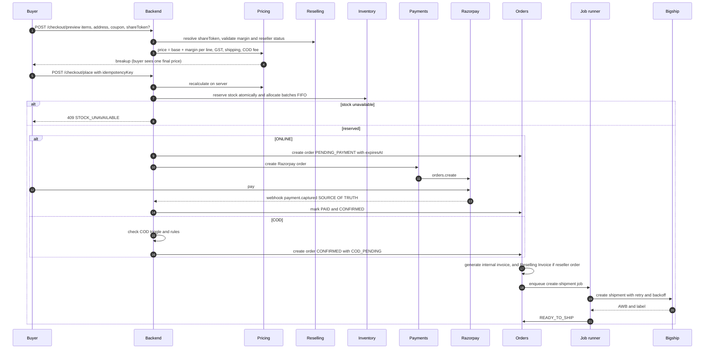

### 6.4 Reselling flow
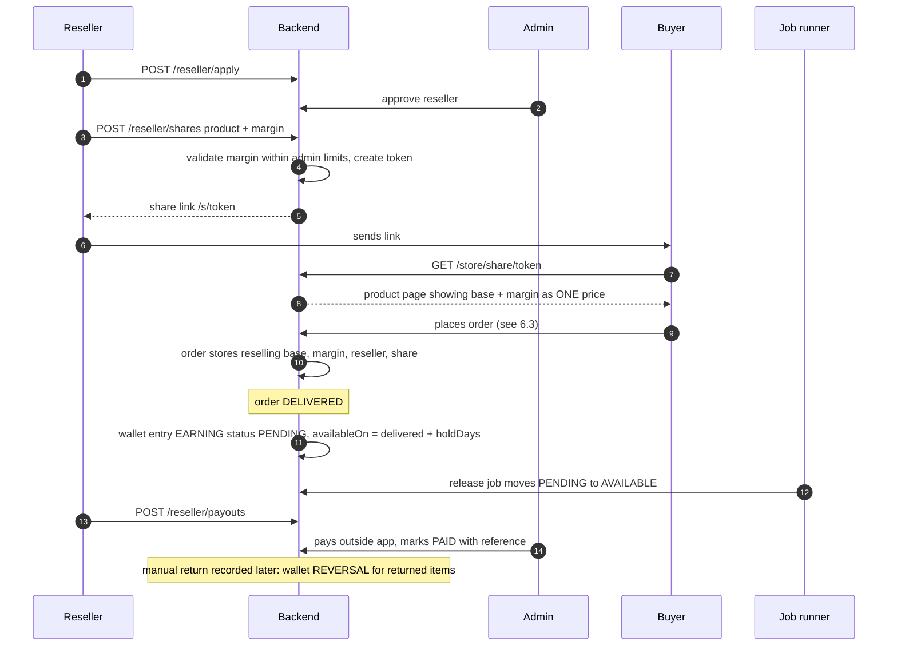

### 6.5 Manual return flow
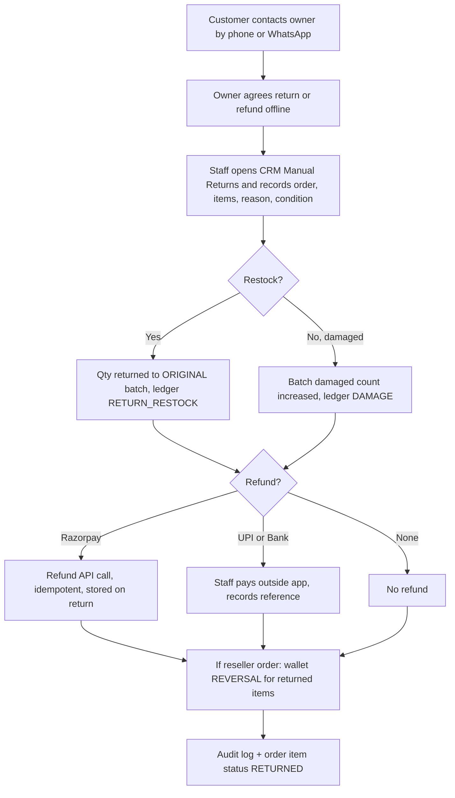

### 6.6 Order state machine
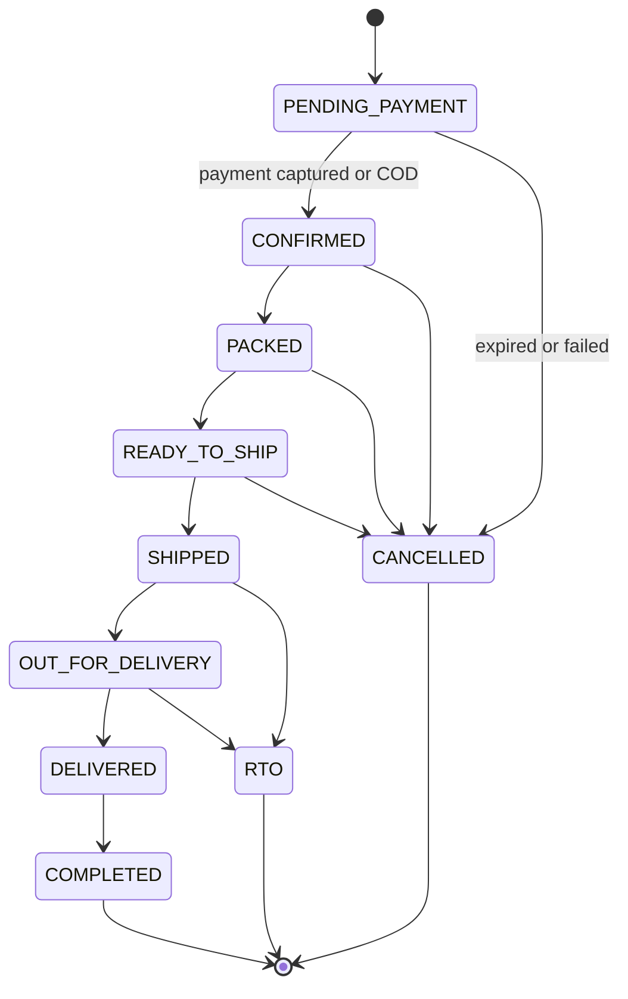

### 6.7 Stock and batch flow
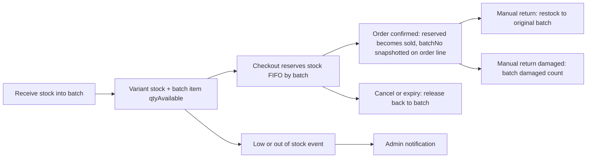

### 6.8 Notification flow
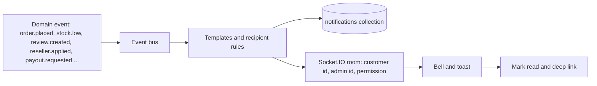

---

## 7. Database Design

> All money = **integer paise**. All collections have `createdAt`/`updatedAt`. Indexes listed are required.

### 7.1 ER overview
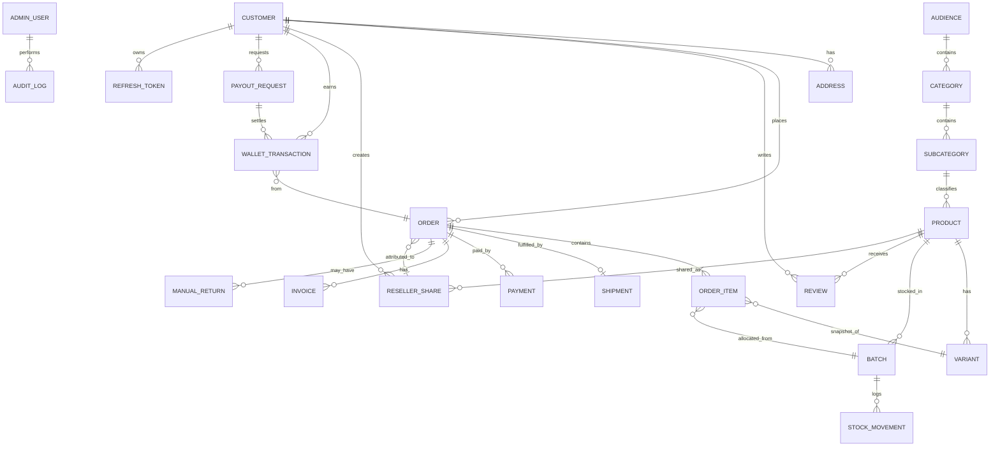

### 7.2 Collections

#### `admin_users`
```
name, email (unique, lowercase), passwordHash (select:false), role: SUPER_ADMIN|STAFF,
permissions[] (from shared-constants), isActive, lastLoginAt, passwordChangedAt,
failedAttempts, lockUntil
```
#### `customers`
```
name, email (unique sparse, lowercase), phone (unique sparse), passwordHash (select:false),
gender?, dob?, isBlocked, blockReason?, codRestricted,
emailVerified, phoneVerified, emailVerifyTokenHash?, resetTokenHash?, resetTokenExpiresAt?,
failedAttempts, lockUntil, lastLoginAt, passwordChangedAt,
stats { totalOrders, deliveredOrders, cancelledOrders },
notificationPrefs { orders, offers },
// reselling (single source of truth = resellerStatus; isReseller is a virtual = status === APPROVED)
resellerStatus: NONE|PENDING|APPROVED|REJECTED|SUSPENDED (default NONE),
resellerCode (unique sparse), resellerBusinessName?, payoutDetails (ENCRYPTED: upi / bank / pan),
isDeleted, deletedAt
```
#### `refresh_tokens`
```
userType: ADMIN|CUSTOMER, user, tokenHash (SHA-256, never the raw token), family,
replacedByTokenHash?, replacedAt?, revokedAt?, expiresAt (TTL index), userAgent, ip
```
Rules: rotate on every refresh; reuse of a rotated token outside the 10-second grace window revokes the whole family; max 10 active sessions per user.
#### `addresses`
```
customer, name, phone, line1, line2, landmark, city, state, pincode (6 digits), country="IN",
type: HOME|WORK|OTHER, isDefault        // max 10 per customer
```
#### `audiences` / `categories` / `subcategories`
```
audience:    name (Men|Women|Kids), slug, image, sortOrder, isActive
category:    audience, name, slug, image, sortOrder, isActive, defaultSizeChart?
subcategory: category, name, slug, image, sortOrder, isActive
```
#### `attributes`, `size_charts`
```
attribute: type (COLOR|FABRIC|FIT|PATTERN|OCCASION|SLEEVE|NECK), name, value, sortOrder
size_chart: name, category?, unit: INCH|CM, columns[], rows[{ size, values{} }]
```
#### `products`
```
name, slug (unique), description, highlights[], audience, category, subcategory, brand="Younora",
fabric, fit, pattern, occasion, careInstructions, countryOfOrigin,
hsnCode, gstPercent, sizeChart, tags[], seo{title,description,keywords},
returnPolicyText?   // display only; returns are manual
colors[{ name, hex, images[{url,publicId,alt,sortOrder}], video? }],
priceRange{minSelling,maxSelling,minMrp,maxMrp}, rating{avg,count,breakdown}, totalStock,
status: DRAFT|ACTIVE|HIDDEN, isFeatured, isNewArrival, isBestSeller,
resellingEnabled (bool, default true), isDeleted
```
Indexes: `slug`, `{audience,category,subcategory,status}`, text(`name,tags,description`), `{status,createdAt}`.
#### `variants`
```
product, sku (unique), barcode?, color{name,hex}, size,
mrp, sellingPrice (BASE price), costPrice, stock, reservedStock, lowStockThreshold,
weightGrams, lengthCm, breadthCm, heightCm, isActive
```
Unique `{product,color.name,size}`. `sellingPrice ≤ mrp`.
#### `batches`
```
batchNo (unique), product, receivedOn, supplier{name,ref}, costPerUnit?,
items[{ variant, qtyReceived, qtyAvailable, qtyReserved, qtySold, qtyReturned, qtyDamaged }],
status: ACTIVE|EXHAUSTED|QUARANTINED, notes
```
#### `stock_movements` (immutable)
```
variant, batch, type: RECEIVE|RESERVE|RELEASE|SALE|RETURN_RESTOCK|DAMAGE|ADJUST|CANCEL,
qty (+/-), balanceAfter, refType: ORDER|MANUAL_RETURN|MANUAL, refId, actor, note
```
#### `carts`, `wishlists`
```
cart: customer, items[{ variant, qty, addedAt }], couponCode?, shareToken?   // prices never stored
wishlist: customer, product, addedAt   // unique {customer, product}
```
#### `orders`
```
orderNo, customer?, guest{name,email,phone}?, 
items[{ product, variant, name, sku, color, size, image, hsnCode, gstPercent,
        batchNo, batch, mrp,
        baseSellingPrice, marginPerUnit (0 if not reseller order), sellingPrice (= base + margin, what buyer pays),
        qty, discount, taxableValue, gstAmount, lineTotal,
        itemStatus: ACTIVE|CANCELLED|RETURNED }],
shippingAddress{snapshot}, billingAddress{snapshot},
pricing{ itemsTotal, discount, couponCode, couponDiscount, taxableAmount, gstTotal{cgst,sgst,igst}, shippingFee, codFee, roundOff, grandTotal },
payment{ method: ONLINE|COD, status: PENDING|PAID|FAILED|REFUNDED|PARTIAL_REFUND|COD_PENDING|COD_COLLECTED, paidAt },
status, statusHistory[{status,at,by,note}],
codConfirmation{required,status,at}, packingProof[{url,type,at,by}],
reselling{ isResellerOrder, reseller, share, baseAmount, marginTotal, buyerAmount },
invoices[ref], shipment (ref), expiresAt, idempotencyKey (unique), source: WEB|ADMIN, notes[]
```
Indexes: `orderNo`, `customer+createdAt`, `status+createdAt`, `idempotencyKey`, `reselling.reseller+createdAt`.
#### `payments`
```
order, method, provider: RAZORPAY|COD, amount, currency,
razorpayOrderId, razorpayPaymentId, status: CREATED|AUTHORIZED|CAPTURED|FAILED|REFUNDED|PARTIAL_REFUND,
refunds[{ razorpayRefundId, amount, status, reason, at, manualReturn? }], webhookEvents[{ eventId, type, receivedAt }]
```
#### `invoices`
```
order, type: INTERNAL|RESELLING, number (INV/2627/00001 or RINV/2627/00001),
financialYear, pdfUrl, issuedTo: { name, address, gstin? }, totals{...}, generatedAt
```
INTERNAL = Younora's own invoice (base price, batch per line). RESELLING = addressed to the buyer at final price with hidden fields stripped.
#### `shipments`
```
order, type: FORWARD, provider: BIGSHIP, bigshipOrderId, awb, courier, labelUrl, manifestUrl, trackingUrl,
status: CREATED|PICKUP_SCHEDULED|PICKED_UP|IN_TRANSIT|OUT_FOR_DELIVERY|DELIVERED|NDR|RTO_INITIATED|RTO_DELIVERED|CANCELLED|FAILED,
rawStatus, trackingEvents[], weight, dimensions, charges, attempts, lastError, lastSyncedAt
```
#### `manual_returns`
```
returnNo, order, items[{ orderItem, qty, reason, condition: RESELLABLE|DAMAGED }],
restock (bool), refund{ amount, mode: RAZORPAY|UPI|BANK|NONE, status, razorpayRefundId?, reference?, note },
resellerReversalDone (bool), handledBy, notes, status: OPEN|CLOSED
```
#### `reseller_shares`
```
reseller, product, token (unique, random), marginPerUnit (paise), isActive, clicks, ordersCount, createdAt
```
#### `wallet_transactions` (immutable ledger)
```
reseller, type: EARNING|REVERSAL|PAYOUT|ADJUSTMENT, amount (+/-),
status: PENDING|AVAILABLE|PAID|REVERSED, order, orderItem, availableOn, payoutRequest?, note, idempotencyKey (unique)
```
Wallet balances are **always computed** from this ledger.
#### `payout_requests`
```
reseller, amount, status: REQUESTED|PAID|REJECTED, paidRef?, paidAt?, handledBy?, note
```
#### `reviews`
```
product, variant?, customer, order, rating, title, comment, photos[], fitFeedback?,
status: VISIBLE|HIDDEN|PENDING, hiddenReason?, isVerifiedPurchase, adminReply{text,by,at}, reportedCount, helpfulCount
```
Unique `{customer, product, order}`.
#### `coupons`
```
code (unique), type: PERCENT|FLAT, value, maxDiscount?, minCartValue, scope: ALL|CATEGORY|PRODUCT, scopeIds[],
usageLimit, perUserLimit, usedCount, startsAt, expiresAt, isActive, firstOrderOnly?, paymentMethodRestriction?
```
#### CMS and misc
```
banners: image(desktop,mobile), title, link, position, sortOrder, startsAt, endsAt, isActive
cms_pages: slug, title, content, isActive
home_sections: type, title, config, sortOrder, isActive
enquiries: name, email, phone, message, status: NEW|REPLIED|CLOSED, reply
```
#### `settings` (single document)
```
store{name,email,phone,address,gstin,stateCode,logo},
payments{ onlineEnabled, codEnabled, codMinOrder, codMaxOrder, codFee, codBlockedPincodes[] },
shipping{ freeShippingAbove, flatFee, pickupAddress, defaultPackaging },
returns{ policyText, windowDays },                 // display only
tax{ pricesInclusiveOfTax },
invoice{ prefix, footerNote, termsText },
reselling{ enabled, marginLimitsByCategory{ categoryId: {minPaise, maxPaise|maxPercent} }, defaultMaxMarginPercent=40,
           priceMayExceedMrp=false, couponsAllowedOnResellerOrders=false, holdDays=7, minPayout, hiddenFields{} },
notifications{ adminEvents{} }, reviews{ moderationMode: AUTO|HOLD }
```
#### `notifications`, `jobs`, `audit_logs`, `counters`
```
notifications: recipientType: CUSTOMER|ADMIN, recipient, type, title, body, deepLink, data, readAt?   (TTL 90 days)
jobs: type, payload, status: PENDING|RUNNING|DONE|FAILED, attempts, maxAttempts, runAt, lockedAt, lastError, idempotencyKey (unique)
audit_logs (immutable): actor, action, entity, entityId, before (redacted), after (redacted), ip, at
counters: key ("order-2611","invoice-2627","rinvoice-2627","batch-2611","return-2611"), seq   // atomic $inc
```

---

## 8. Core Business Logic Specs

### 8.1 Pricing engine (`modules/pricing`) — single source of truth
Inputs: variants + qty, coupon, address state, payment method, optional `shareToken`, settings.
1. Load current **base** variant prices from DB. Ignore all client prices.
2. If `shareToken` is valid (active share, reseller APPROVED, product `resellingEnabled`): `sellingPrice = base + share.marginPerUnit`, re-validated against current admin margin limits. Invalid/suspended → fall back to base price (no commission) and report a warning.
3. Line total = `sellingPrice × qty`. Reselling price must not exceed MRP unless `priceMayExceedMrp`.
4. Coupon: validated (scope, min cart, limits, expiry). **Not applied on reseller orders** unless setting allows.
5. GST per line from product `gstPercent` (inclusive or exclusive per setting). Same state → CGST+SGST, else IGST. **GST is computed on the full buyer price** `[CONFIRM with CA]`.
6. Shipping fee (free above threshold, else flat/Bigship rate). 7. COD fee if COD. 8. Round-off → grand total.
Return a full **breakup object** used by preview, checkout and invoices. The reseller commission is computed **from** this breakup (`margin × qty`) and never changes it. **Unit tests ≥ 25 golden cases.**

### 8.2 Stock reservation
Atomic `updateOne({_id, stock:{$gte:qty}}, {$inc:{stock:-qty, reservedStock:qty}})` inside a transaction with batch allocation (FIFO). Online unpaid orders hold stock until `expiresAt` (15 min); a job releases expired reservations. Every change writes `stock_movements`.

### 8.3 Order status
State machine in §6.6. Cancellation allowed only before SHIPPED. Illegal transitions rejected; every change appends `statusHistory`, writes an audit entry and emits an event.

### 8.4 Invoices
- Financial-year numbering: `INV/2627/00001` (internal) and `RINV/2627/00001` (reselling), from `counters`.
- **Normal order:** one invoice (INTERNAL) with GSTIN, HSN, tax breakup, **batch per line**.
- **Reseller order:** two documents created at confirmation: INTERNAL (base price, margin line, batch; CRM only) and RESELLING (to the buyer, final price as one price per item, no margin, no batch by default; optional "Shared by <reseller>" line `[CONFIRM]`).
- PDF via pdfkit, stored in Cloudinary/private storage, downloadable by the right audience only.

### 8.5 COD rules
Global toggle AND order value within min/max AND pincode serviceable and not blocked AND customer not `codRestricted` (set manually by admin). Optional COD fee. COD reseller orders earn only after COD is marked collected.

### 8.6 Reviews
Only customers with a DELIVERED order containing the product may review (verified). Moderation mode AUTO or HOLD. Admin: hide/show with reason, delete, reply, banned-word auto-hold. Aggregates count VISIBLE only and are recalculated on every change.

---

## 9. Reselling Module (Full Spec)

### 9.1 Concept
A reseller chooses a product, sets **their own margin (₹ per unit)** within admin limits, and receives a personal link. The buyer opens the link, sees **one final price (base + margin)**, orders, and Younora ships directly to the buyer. After delivery plus the hold period, the reseller earns the margin into a wallet. The buyer gets a **Reselling Invoice** at the final price. The internal invoice stays in the CRM.

### 9.2 Onboarding
Customer applies (`POST /reseller/apply` with business name, payout details) → status `PENDING` → admin approves/rejects → `APPROVED` (gets `resellerCode`). Admin can `SUSPEND`. `[CONFIRM KYC (PAN/bank) and open-vs-invite signup]`

### 9.3 Margin rules
| Rule | Detail |
|---|---|
| Base price | Variant `sellingPrice` set by admin |
| Margin | Per unit, set per share link; same for all variants of the product (v1) |
| Limits | Admin min/max per category (default max 40% of base). Server rejects out-of-range values, also at order time |
| Buyer price | base + margin as ONE price; must not exceed MRP `[CONFIRM]` |
| Locking | Margin snapshotted on each order line; later edits never change old orders |
| Coupons | Not applied to reseller orders by default |
| Shipping/COD fee | Paid by buyer, not part of margin |
| Commission | `marginPerUnit × qty` on delivered items. Excludes shipping and COD fee |

### 9.4 Earning lifecycle
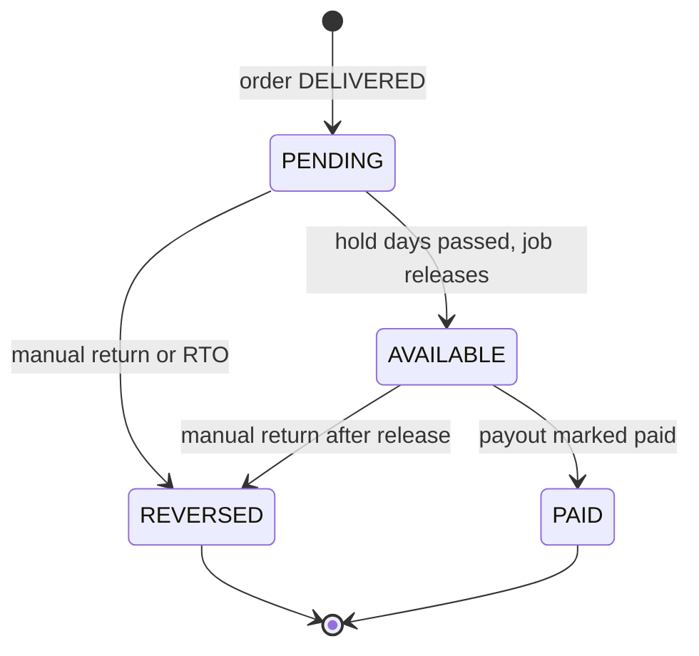
COD reseller orders: `PENDING` starts only after COD collected. Cancelled/RTO: no earning. Reversal creates a **new negative ledger row**; rows are never edited.

### 9.5 Abuse protection
Reseller cannot buy through their own link (same user, phone, or address match); share tokens are random and revocable; suspended resellers' links stop taking new orders; payout details encrypted; wallet ledger immutable and idempotent (unique `idempotencyKey` per order item event).

### 9.6 Payouts
Reseller requests payout (≥ `minPayout`, ≤ available balance). Admin pays **outside the app** (UPI/bank) and marks `PAID` with a reference (permission `payouts.manage`, audited) or rejects with reason. Automatic payouts are deferred. GST/TDS treatment `[CONFIRM with CA before launch]`.

### 9.7 Hidden-details matrix (server-side `resellingView` serializer) `[CONFIRM each row]`
| Detail | Buyer via link | Reseller | Reselling Invoice | Staff without permission |
|---|---|---|---|---|
| Base price | Hidden | Shown (needed to set margin) | Hidden | Shown |
| Reseller margin | Hidden | Own margin only | Hidden | Hidden |
| Final price | Shown | Shown | Shown | Shown |
| Cost price / supplier | Hidden | Hidden | Hidden | Hidden (`inventory.view-cost`) |
| Batch number | Public batch search only | Hidden | Hidden (default) | Inventory screens only |
| Buyer phone / full address | Own | Name + city/state only | Buyer's own | Full (needed to ship) |
| Other resellers' data | n/a | Never | n/a | `resellers.view-sensitive` |
Hidden-field list stored in `settings.reselling.hiddenFields`. **Automated leak tests** assert forbidden keys never appear in reseller/buyer responses or the reselling PDF.

---

## 10. Manual Returns Register
There is **no customer-facing return flow**. The storefront shows a Return Policy page and a "Need to return? Contact us" block. Staff record the outcome in CRM → Manual Returns:
- Select order + items + qty, reason, condition (RESELLABLE / DAMAGED).
- **Restock** → quantity returns to the ORIGINAL batch (`RETURN_RESTOCK` ledger row). Damaged → `DAMAGE` row and batch `qtyDamaged`.
- **Refund** → Razorpay refund (idempotent, partial allowed) or manual UPI/bank with a recorded reference, or none. Refund amount proration (coupon/GST) is calculated by the pricing helper.
- **Reseller order** → automatic wallet `REVERSAL` for the returned items' margin.
- Order item status → `RETURNED`; everything audited.
Flow diagram: §6.5.

---

## 11. Batch System & Batch Search

- **A batch = one received lot of one product**, holding quantities per variant (§7.2).
- **Number format:** `YNR-<YYMM>-<AUD>-<SEQ4>`, e.g. `YNR-2611-WMN-0042`, generated atomically from `counters`. Admin may enter a custom unique value `[CONFIRM]`.
- **Allocation:** FIFO. If an order line spans two batches, split into two allocation entries. `batchNo` is snapshotted on the order line.
- **Receiving:** creates/updates a batch, raises variant stock, writes `RECEIVE` ledger rows.
- **Low stock:** emits `stock.low` / `stock.out` once per threshold crossing.

| Side | Endpoint | Input | Result |
|---|---|---|---|
| CRM | `GET /admin/batches/search?q=` | partial batch no., product name, SKU | Batch card: product, variants and remaining qty, received date, supplier, cost (needs `inventory.view-cost`), **orders sold from it**, manual returns/damages, product link |
| Customer | `GET /store/batch/:batchNo` | exact batch no. (on tag/invoice) | **Public-safe only:** product name, image, color/size in that batch, "Authentic Younora batch", product link. No cost, supplier, stock counts, buyers. Rate-limited, whitelist serializer |

---

## 12. In-App Notification System (v1)
- Persistent `notifications` collection + REST + **Socket.IO** rooms: `customer:<id>`, `admin:<id>`, `admin:perm:<permission>`. Socket auth uses the same JWT (audience checked).
- Templates in code (`templates.js`). Customers can toggle offers; transactional always on.
- Web Push is an **optional later phase** (§24).

| Event | Customer | Admin / Staff |
|---|---|---|
| `order.placed` | ✅ | ✅ new order |
| `payment.failed` | ✅ | ✅ |
| `order.shipped/out_for_delivery/delivered` | ✅ | — |
| `order.cancelled` | ✅ | ✅ |
| `shipment.failed` | — | ✅ retry needed |
| `stock.low` / `stock.out` | — | ✅ |
| `review.created` | — | ✅ |
| `reseller.applied` | — | ✅ |
| `reseller.approved` | ✅ reseller | — |
| `reseller.order.placed` / `reseller.earning.available` | ✅ reseller | — |
| `payout.requested` | — | ✅ |
| `payout.paid` | ✅ reseller | — |
| `manual_return.recorded` | — | (audit only) |

Endpoints: `GET /notifications`, `PATCH /notifications/:id/read`, `PATCH /notifications/read-all`, `GET /notifications/unread-count`.

---

## 13. Bigship Integration `[VERIFY everything against official docs and sandbox before coding]`
Capabilities: auth/token cache, serviceability and rates, pickup warehouse setup, create forward shipment, AWB/courier selection, label/manifest, pickup request, tracking (webhook if available + cron sync), cancel, NDR/RTO visibility. **No reverse pickup** (returns are manual).

Adapter interface (`shipping/providers/provider.interface.js`): `checkServiceability`, `getRates`, `createShipment`, `generateLabel`, `schedulePickup`, `track`, `cancel`, `parseWebhook`.

Reliability: shipment creation is a **job** with retry/backoff (5 attempts), stores `lastError`, emits `shipment.failed`; CRM shows **Retry** and **manual AWB entry**. Idempotent (skip if `bigshipOrderId` stored). Status mapping table in `bigship/mapper.js`; unknown statuses keep `rawStatus` without crashing. Webhook secured by secret/IP allowlist; cron fallback every N minutes.

---

## 14. Payments (Razorpay + COD)
- Amount always computed server-side, sent in paise. Razorpay order `receipt = orderNo`, `notes.orderId`.
- **Webhook is the source of truth** (`payment.captured`, `payment.failed`, `refund.processed`, `refund.failed`, `order.paid` `[VERIFY]`). Verify `X-Razorpay-Signature` on the **raw body**; store event ids; ignore duplicates.
- Client `/payments/razorpay/verify` is for instant UI only.
- Handle tab-closed-after-pay, failed-then-retry, amount mismatch (flag), expired pending orders (release stock).
- Refunds via Razorpay refund API (partial allowed), idempotent, stored on `payments.refunds[]`.
- COD: `COD_PENDING` → `COD_COLLECTED` on delivery or manual mark. COD refunds are manual (UPI/bank reference).
- Admin controls: COD toggle (audited, permission `payments.settings`), limits, fee, blocked pincodes, online ON/OFF.

---

## 15. Folder Structure

### 15.1 Monorepo
```
younora/
├─ apps/
│  ├─ backend/       # Node + Express API   (built first)
│  ├─ crm/           # React + Vite admin   (built second)
│  └─ storefront/    # Next.js customer site + reseller panel (built third)
├─ packages/
│  └─ shared-constants/   # roles, permissions, statuses, enums
├─ docs/
│  ├─ PLAN.md  ·  phases/ (PROGRESS.md, B*-signoff.md, F*-signoff.md)  ·  api/ (OpenAPI, Postman, samples/)  ·  decisions/
├─ reference/        # old Green Tree code, read-only, git-ignored
├─ PROJECT_RULES.md  # copy of §2 and §3
├─ .github/workflows/ · .editorconfig · .prettierrc · eslint.config.js · package.json (workspaces)
```
### 15.2 Backend
```
apps/backend/src/
├─ server.js  app.js
├─ config/    env.js db.js cloudinary.js razorpay.js mail.js
├─ core/
│  ├─ errors/  http/  events/ (eventBus, events.js)  jobs/ (runner, registry)  logger.js
│  ├─ middleware/ authenticate authorize rateLimit validate upload idempotency
│  ├─ mail/ mailer.js        └─ utils/ money.js slug.js counters.js crypto.js cookies.js dates.js
├─ modules/
│  ├─ auth/  users/ (adminUser, customer, address, refreshToken models)  audit/
│  ├─ notifications/  catalog/ (audience category subcategory attribute sizeChart product variant)
│  ├─ inventory/ (batch, movements, allocation, batchSearch)  storefront/ (public read)
│  ├─ wishlist/  cart/  pricing/  coupons/  settings/
│  ├─ checkout/  orders/ (+invoices)  payments/
│  ├─ shipping/ (providers/bigship, jobs)  reselling/ (shares, earnings, wallet, payouts, resellingView)
│  ├─ manualReturns/  reviews/  cms/  enquiry/  reports/
├─ jobs/    # cron registrations: release reselling holds, expire unpaid orders, tracking sync
├─ seed/    # admin.seed.js, taxonomy seed, demo data
└─ tests/   # unit/ integration/ e2e/ helpers/
```
Each module: `<name>.model.js · .validation.js · .routes.js · .controller.js · .service.js · .events.js · README.md`.

### 15.3 CRM and storefront
```
apps/crm/src/        app/ (router, providers, guards)  components/ (ui, layout, data, form)
                     features/ (auth dashboard catalog inventory orders shipping manualReturns reviews customers
                                resellers coupons cms settings staff notifications reports)
                     lib/ (axios, socket, formatters)  store/  styles/
apps/storefront/src/ app/ (shop, checkout, account, reseller, auth, content, batch, share/[token])
                     components/ (ui, layout, product, cart, checkout, review, reseller, notification)
                     features/  lib/  styles/   public/ (manifest, icons)
```

---

## 16. API Surface
Base `/api/v1`. **Pub** = public, **C** = customer, **R** = approved reseller, **A** = admin/staff with permission.

### 16.1 Auth and profile
| Endpoint | Access |
|---|---|
| `POST /auth/admin/login · /logout · /refresh` | Pub / A (cookie `ynr_admin_rt`, path `/api/v1/auth/admin`) |
| `GET/PATCH /admin/me`, `POST /admin/me/change-password` | A |
| `POST /auth/customer/register · /login · /logout · /refresh · /forgot-password · /reset-password · /verify-email · /resend-verification` | Pub / C (cookie `ynr_cust_rt`, path `/api/v1/auth/customer`) |
| `GET/PATCH /me`, `POST /me/change-password` | C |
| `/addresses` CRUD, `PATCH /addresses/:id/default` | C |
| `/admin/staff` CRUD + deactivate/reactivate | A (`staff.manage`) |
| `GET /admin/audit-logs` | A (`audit.read`) |

### 16.2 Catalog, inventory (admin)
`CRUD /admin/audiences · categories · subcategories · attributes · size-charts`; `CRUD /admin/products` (+ `/variants` upsert, `/duplicate`, `/status`); `POST /admin/products/import · GET /export · GET /import/template`; `POST /admin/uploads`, `DELETE /admin/uploads/:publicId`;
`CRUD /admin/batches`, `POST /admin/batches/:id/receive`, `GET /admin/batches/search`, `POST /admin/inventory/adjust`, `GET /admin/inventory/movements · /low-stock`, `GET /admin/reports/batch-wise`.

### 16.3 Storefront public
`GET /store/home · /menu · /products · /products/:slug · /products/:slug/similar · /search · /search/suggest · /filters · /pincode/:pin · /pages/:slug · /banners`, **`GET /store/batch/:batchNo`**, **`GET /store/share/:token`**, `POST /store/enquiry`.

### 16.4 Customer actions
`/cart` (GET, add, qty, remove, apply/remove coupon, merge-guest), `/wishlist`, `POST /checkout/preview`, `POST /checkout/place`, `POST /payments/razorpay/verify`, `POST /payments/razorpay/retry/:orderId`, `GET /orders`, `GET /orders/:id`, `POST /orders/:id/cancel`, `GET /orders/:id/invoice`, `GET /orders/:id/track`, `POST /reviews`, `GET /me/reviews`, `PATCH/DELETE /reviews/:id`, `POST /reviews/:id/report`, `POST /reviews/:id/helpful`, notifications (§12).

### 16.5 Reseller (R)
`POST /reseller/apply` (C), `GET /reseller/me`, `PATCH /reseller/me` (payout details), `POST /reseller/shares`, `GET /reseller/shares`, `PATCH /reseller/shares/:id` (margin/active), `GET /reseller/orders`, `GET /reseller/wallet` (balance + ledger), `POST /reseller/payouts`, `GET /reseller/payouts`.

### 16.6 Webhooks
`POST /webhooks/razorpay`, `POST /webhooks/bigship` `[VERIFY]`.

### 16.7 Admin operations
Orders: `/admin/orders` (list/filter/search/export), `/:id`, `PATCH /:id/status`, `POST /:id/cancel`, `/packing-proof`, `/notes`, `/shipment/retry`, `/shipment/manual-awb`, `GET /label · /invoice · /packing-slip`, `POST /admin/orders/manual`, `/mark-cod-collected`, `/refund`.
Shipments: `/admin/shipments` (list, sync, pickup).
**Manual returns:** `POST/GET /admin/manual-returns`, `GET/PATCH /:id`, `POST /:id/refund`.
**Resellers:** `GET /admin/resellers`, `PATCH /:id/approve · /reject · /suspend · /reactivate`, `GET /:id/wallet`, `POST /:id/wallet/adjust`, `GET /admin/payouts`, `POST /admin/payouts/:id/mark-paid · /reject`, `GET /admin/reselling/orders`, `GET /admin/reselling/invoices`, `GET /admin/reselling/invoices/:id/pdf`.
Reviews: `/admin/reviews` (list, hide, show, reply, delete, bulk). Customers: `/admin/customers` (list, `/:id`, `/block`, `/cod-restrict`, `/notes`). `/admin/coupons`, `/banners`, `/home-sections`, `/pages`, `/enquiries` CRUD. `/admin/settings` (GET/PATCH by section incl. `reselling`, `payments`), `/admin/dashboard/*`, `/admin/reports/*`.

---

## 17. Backend Phase Plan (B0–B13)

> **Each phase is a complete specification.** The agent follows §2 for every phase: briefing → permission → code → sign-off → commit + tag → stop. "Tag" below is the tag proposed in the final hand-over.
> Estimates assume one developer with AI help.

### Phase B0 — Foundation ✅ *(done, tag v0.0.0)*
Monorepo, lint/format, Express 5 app, env validation, pino, helmet/CORS/rate-limit, error + response format, health endpoints, Jest setup, CI.

---

### Phase B1 — Auth, Users, Roles & Permissions *(4–5 d, tag v0.1.0)*
**Status:** Slice 1 (models + constants) done. **Resume at Slice 2.** Locked decisions below must not change without the owner's approval.

**Goal:** Secure authentication for admins (CRM) and customers (storefront), staff permissions, addresses, and the audit trail.

**Locked decisions**
1. Only `packages/shared-constants` is shared. Zod schemas live in each module's `<name>.validation.js`.
2. Tokens: access JWT 15 min (`aud` = `younora:admin` or `younora:customer`); refresh token random, stored **hashed** in `refresh_tokens`, rotated on every use, family revoked on reuse (10-second grace window for parallel calls), max 10 sessions/user.
3. Cookies: `ynr_admin_rt` (path `/api/v1/auth/admin`) and `ynr_cust_rt` (path `/api/v1/auth/customer`), httpOnly, SameSite=Lax, Secure outside local.
4. `authenticate` loads the user from the **database**; role and permissions come from the DB, not the token. `SUPER_ADMIN` bypasses permission checks. Inactive/blocked users get 401/403 even with a valid token. Access tokens issued before `passwordChangedAt` are rejected.
5. Lockout: 5 failed logins → locked 15 minutes (admins and customers), plus IP rate limit. Generic error "Invalid email or password". Emails lowercased.
6. `forgot-password` always returns the same 200. Reset/verify tokens are hashed, expiring, single use. Password change/reset revokes other sessions.
7. Customer login is **email + password** with email verification (no SMS). Mailer via Nodemailer (`jsonTransport` in tests); never log tokens.
8. A Super Admin cannot deactivate themselves or the last active Super Admin.
9. Addresses: max 10, hard delete (orders keep snapshots), promote another default when the default is deleted, pincode 6 digits, phone 10-digit Indian.
10. Seed script is idempotent and refuses the placeholder password in production.
11. Audit log is immutable (no update/delete routes) and redacts password hashes, tokens and payout details.
12. `resellerStatus` is the single source of truth; `isReseller` is a virtual.

**Slices**
1. Models and constants ✅ (adminUser, customer, address, refreshToken, permissions).
2. Admin auth: token utils, cookies helper, `authenticate`, `authorizeRole`, `requirePermission`, admin login/logout/refresh/me, seed script.
3. Staff CRUD (`/admin/staff`, create, list, get, update, deactivate, reactivate).
4. Customer auth: register, login, logout, refresh, forgot/reset, verify-email, resend-verification, mailer.
5. Profiles and addresses: `/me`, `/admin/me`, change-password, address CRUD with atomic default switching.
6. Audit module (`logAction`, `GET /admin/audit-logs`) wired into staff changes, permission changes, password changes, admin login; final hardening and Postman collection.

**Tests:** wrong password, lockout and unlock, expired/invalid token, refresh rotation, reuse detection, grace window, customer token rejected on admin routes (and vice versa), staff without permission gets 403, permission change effective on next request, deactivated/blocked user rejected, reset-token expiry and single use, password change revokes sessions, cookie flags, last-Super-Admin protection, address default switching and ownership isolation, audit redaction.
**Gate:** security review of the whole auth diff by the owner.

---

### Phase B2 — In-App Notifications *(2–3 d, v0.2.0)*
**Goal:** Event bus and in-app notifications so every later phase only emits events.
**Build:** `core/events/eventBus.js` + `events.js`; `notifications` model with TTL; service (create, list paginated, unread count, mark read/all, delete); Socket.IO server with JWT auth and rooms (`customer:<id>`, `admin:<id>`, `admin:perm:<perm>`); template registry; preference check; dev-only test emitter.
**Endpoints:** §12.
**Tests:** notification saved; delivery only to the right room; unauthenticated socket rejected; read/unread counts; preferences respected; admin permission room routing.
**Gate:** test emitter shows a live toast in a simple dev HTML page.
**Out of scope:** Web Push, email notifications, business events.

---

### Phase B3 — Catalog Taxonomy, Attributes, Size Charts, Media *(3 d, v0.3.0)*
**Build:** audience (seed Men/Women/Kids), category, subcategory with ObjectId refs, slug generation, sort, active flags, soft delete; attributes; size charts; Cloudinary upload service (folder per entity, type/size limits, delete by publicId); `/store/menu` tree (public).
**Reuse:** `reference/` cloudinary config and upload ideas.
**Tests:** unique slugs, cannot delete category with active products, tree ordering, upload rejects wrong type/size, permission checks (`categories.manage`).
**Gate:** manage tree and size charts end-to-end in Postman.

---

### Phase B4 — Products & Variants *(6–8 d, v0.4.0)* — *heart of the catalog*
**Build:** `products` + `variants`; create/update product with **color-wise images** and a **variant matrix** in one transaction; per-variant MRP/base price/cost/stock/SKU (auto `YNR-<CAT>-<PROD>-<COLOR>-<SIZE>`), barcode optional; validations (price ≤ MRP, unique SKU, unique product+color+size, ≥1 image per color, HSN/GST); denormalised `priceRange`/`totalStock`; status workflow; flags incl. `resellingEnabled`; duplicate; soft delete; admin list with search/filter/sort/pagination/low-stock; **Excel/CSV import/export** with template, dry-run and row-error report; audit on price/stock edits. Cost price visible only with `inventory.view-cost`.
**Tests:** matrix create/edit (add/remove size/color), per-size price, duplicate SKU rejected, rollback on failure, import bad rows report, denormalised fields correct, permissions.
**Gate:** create 10 realistic Younora products via API (men/women/kids, multi colour/size) and review the data shape.

---

### Phase B5 — Inventory & Batches *(4–5 d, v0.5.0)*
**Build:** `batches`, `stock_movements`, `counters`; batch number generator (atomic); receive stock; manual adjust (mandatory reason), damage write-off, quarantine; **FIFO allocation service** `allocate(variantId, qty)` returning batch splits; low-stock events; batch reports (stock/sold/damaged by batch); stock-receive Excel import; **CRM batch search** (§11).
**Tests:** batch number uniqueness under parallel requests; FIFO across batches; stock never negative; ledger sums equal stock; low-stock event emitted once per crossing; search by partial batch/product/SKU; cost hidden without permission.
**Gate:** 50 parallel reserve attempts on stock 10 → exactly 10 succeed.

---

### Phase B6 — Storefront Read APIs *(4–5 d, v0.6.0)*
**Build:** listing with filters (size, color, price, fabric, rating, discount, in-stock), sort, pagination, facets; product detail by slug (variants grouped by colour, size availability, size chart, rating placeholder); search + suggestions; similar products; home/banners/sections read; wishlist; **public batch lookup** (§11); ETag/cache headers.
**Tests:** every filter combo; pagination edges; draft/hidden never exposed; price filter uses variant prices; batch lookup returns only whitelisted fields and is rate-limited; typical response < 300 ms on dev data.
**Gate:** listing and detail contracts frozen in OpenAPI (frontend depends on them).

---

### Phase B7 — Cart, Pricing Engine, Coupons, Settings *(5–6 d, v0.7.0)*
**Build:** pricing module per §8.1 (pure functions + service) including **reseller margin pricing and validation**; coupons CRUD + validation engine; cart (variant-aware, max qty, stock checks, guest merge, price/stock change warnings, `shareToken` carried on cart); settings module (store, GST, shipping, payments, reselling limits, reviews mode) with audit; pincode serviceability stub (local table until B9).
**Tests:** **≥ 25 golden pricing cases** (coupon types, GST modes, intra/inter-state, rounding, COD fee, free shipping, **reseller margin within/outside limits, MRP cap, coupon blocked on reseller order**); coupon abuse; qty > stock; removed variant; guest merge.
**Gate:** pricing tests reviewed and approved by the owner (+ CA review of GST logic).

---

### Phase B8 — Checkout, Orders, Payments, Invoices *(8–10 d, v0.8.0)* — *highest risk*
**Build:** `orders`, `payments`, `invoices`; numbering; `checkout/preview` and `checkout/place` (idempotency key, transactional): recalc → COD rules → reserve + allocate batches → order snapshot incl. `batchNo`, base price, margin; Razorpay create/verify/**webhook** (raw body, signature, event log), retry, expiry job; COD flow + mark collected; order lifecycle service (§6.6), cancel rules, admin status updates, **manual (phone) order**, packing proof; **INTERNAL invoice PDF** (batch per line, GST breakup) and **RESELLING invoice PDF** (hidden fields stripped), packing slip; refund service (cancel before ship); events to notifications; customer/admin order APIs and export. Reseller attribution stored on the order (earnings logic comes in B10).
**Tests:** tampered price/margin ignored; duplicate submit → one order; two buyers last item → one wins; webhook replay idempotent; webhook before/after client verify; pay fail then retry; expiry releases stock; COD disabled/rules; invoice batch and totals correct; reselling invoice contains no margin/batch; illegal transitions rejected; refund idempotent.
**Gate:** full e2e (browse → cart → checkout → Razorpay test pay → order → invoice) green, plus manual test with Razorpay test cards/UPI.

---

### Phase B9 — Shipping with Bigship *(6–8 d, v0.9.0)*
**Build:** read Bigship docs and sandbox first; save samples to `docs/api/samples/`; client (token cache, retry, timeout, error normalisation); provider interface + mapper + status table; serviceability/rates wired to `/store/pincode/:pin` and checkout; **shipment job** (queue, retry, backoff, idempotency, weight/dimensions); label/manifest, pickup, cancel; tracking webhook + cron fallback updating order status and emitting events; admin retry, force-sync, manual AWB, shipments list; COD reconciliation (delivered → COD collected).
**Tests:** sandbox e2e; API down → order still created, job retries, admin alerted; duplicate job → one shipment; unknown status handled; cancel after AWB; webhook auth.
**Gate:** 3 real sandbox shipments (prepaid, COD, cancelled) reflected correctly in CRM data.

---

### Phase B10 — Reselling *(6–8 d, v0.10.0)*
**Build (per §9):** reseller apply/approve/reject/suspend; share links (margin validation, token, click count); public share endpoint; order attribution checks (self-purchase block); **earning creation on DELIVERED** (and on COD collected) as PENDING ledger rows; **hold-release job**; reversal on RTO/cancel; wallet ledger + balance computation; payout request/mark-paid/reject; admin wallet adjust (audited); reselling orders list for reseller and admin; admin reselling-invoices list + PDF download; `resellingView` serializer + settings-driven hidden fields; encrypted payout details; notifications (§12); reseller reports.
**Tests:** margin limits enforced at share time and order time; earning created once (idempotent) on delivery; hold release; COD earning only after collection; reversal rows; balance equals ledger sum; payout cannot exceed available; self-purchase blocked; suspended link rejected; **leak tests** (no base price/margin/cost/batch where hidden; no other resellers' data); payout details encrypted at rest.
**Gate:** full scenario passes: share → buyer orders → delivered → pending → released → payout paid; and the same with a return reversal.

---

### Phase B11 — Manual Returns & Reviews *(4–5 d, v0.11.0)*
**Build:** manual returns register (§10): create/list/get/update, restock to original batch, damage write-off, Razorpay refund (idempotent, partial) or manual refund record, reseller wallet reversal, item status RETURNED, audit; reviews (verified purchase, one per product per order, photos, fit feedback, public list/helpful/report, admin list/filter/hide/show/reply/delete/bulk, banned-word hold, moderation mode, aggregate recalculation, `review.created` event).
**Tests:** return updates stock, batch, ledger, refund and wallet consistently; refund idempotency; partial refund proration; unverified/duplicate review blocked; hidden review excluded from public + aggregates; aggregate math; permissions.
**Gate:** 4 scenarios walked through (resellable restock, damaged, partial refund, reseller-order return) with correct stock/ledger/refund/wallet results; product API returns real rating summary.

---

### Phase B12 — CMS, Enquiry, Dashboard, Reports *(4–5 d, v0.12.0)*
**Build:** banners, home sections, static pages, announcement bar (admin CRUD + public read); enquiries with status/reply; dashboard KPIs (sales 1/7/30d, orders by status, AOV, top products/categories, low stock, pending reviews, COD vs prepaid, reselling sales and payouts due); reports (sales, GST invoice-wise, batch-wise, manual returns, reselling, customers) with Excel/CSV export; audit viewer filters; scheduled jobs registry.
**Tests:** aggregations vs seeded data; date boundaries in IST; export content; jobs idempotent.
**Gate:** dashboard reconciles with raw orders on a seeded dataset.

---

### Phase B13 — Hardening, Docs & Backend Release *(4–6 d, v1.0.0-rc.1)*
**Build:** security pass (§20), dependency audit, CORS whitelist, per-route rate limits, payload limits; indexes review, slow queries, pagination everywhere, compression; request ids, error tracking `[CONFIRM Sentry]`; full OpenAPI + Postman, env docs, runbooks (webhook failures, stuck shipments, stock mismatch repair); backup/restore drill; demo seed; load test (k6/Artillery); deploy to staging with Razorpay test + Bigship sandbox.
**Gate (BACKEND RELEASE CANDIDATE):** CI green, load test acceptable, docs complete, staging stable 3 days → frontend may start. **Backend total ≈ 10–13 weeks.**

---

## 18. Frontend Phase Plan (F0–F11)

> Starts only after the Backend RC (B13). Same protocol as §2: briefing → permission → code → sign-off → commit + tag → stop. Frontend consumes the OpenAPI contract and never recalculates prices, margins or totals itself.
> Common rules: Tailwind with tokens from §4; TanStack Query for server state; React Hook Form + Zod for forms; one axios client with auth refresh and normalised errors; every list has loading, empty and error states; money formatted from paise; responsive; WCAG AA basics. Tags: `fe-v0.<N>.0`.

### Phase F0 — Design System & Setup *(3–4 d, fe-v0.0.0)*
Create `apps/crm` (Vite) and `apps/storefront` (Next.js). Tailwind config with Younora tokens, fonts, logo SVG/favicons, Lucide icons. Base components: Button, Input, Select, Checkbox, Radio, Switch, Modal, Drawer, Tabs, Badge, Toast, Tooltip, Skeleton, EmptyState, Pagination, Breadcrumb, DataTable shell. API client (interceptors, refresh with cookies, error normalisation). `/design` showcase page.
**Tests:** component render tests (Vitest + Testing Library). **Gate:** owner approves the visual language.

### Phase F1 — CRM Shell, Auth & Permissions *(3 d, fe-v0.1.0)*
Login, session handling, protected routes, permission guards (menu items and routes hidden by permission), layout (sidebar, topbar, breadcrumbs), profile + change password, staff management UI (create, permissions, deactivate), global error/empty states, 401 handling.
**Tests:** login/logout/refresh, route guard by permission, session-expiry UX.

### Phase F2 — CRM Catalog *(8–10 d, fe-v0.2.0)*
Audience/category/subcategory/attribute/size-chart screens; **Product form** (steps: basics → media per colour → **variant matrix editor** → pricing/stock → SEO/flags incl. reselling toggle → review); product list (filters, bulk status/price); import/export UI with error report; image upload with reorder/preview; cost price shown only with permission.
**Tests:** create/edit with matrix, validation messages, large-image handling, bulk import error display.

### Phase F3 — CRM Inventory & Batches *(4 d, fe-v0.3.0)*
Batch list/detail, **receive-stock form** (auto batch number, per-variant quantities), adjust stock, movement ledger, low-stock page, batch reports, **global batch search box** in the topbar (batch card with orders sold, damages, product link).

### Phase F4 — CRM Orders, Shipping & Payments *(7–8 d, fe-v0.4.0)*
Orders table (filters, search, export); order detail (timeline, items with **batch no.**, payment, shipment, notes, packing-proof upload, reselling info for reseller orders); status actions with confirmation; internal invoice / packing slip / label buttons; retry shipment + manual AWB; manual (phone) order creation; COD toggle and rules UI; refund UI.

### Phase F5 — CRM Manual Returns, Reviews, Customers *(4–5 d, fe-v0.5.0)*
**Manual Returns Register**: create from an order (items, qty, reason, condition, restock toggle, refund mode/amount/reference), list/detail, refund trigger. Reviews moderation (hide/show/reply/bulk, filters). Customers (list, order history, block/unblock, COD restrict, notes).

### Phase F6 — CRM Reselling *(5–6 d, fe-v0.6.0)*
Resellers list with status filters, approve/reject/suspend, reseller detail (shares, orders, wallet ledger), wallet adjust, **payout queue** (mark paid with reference / reject), reselling orders, **Reselling Invoices section** (filter, preview, download PDF), reselling settings (margin limits per category, hold days, min payout, MRP cap, hidden-field toggles). Sensitive columns obey `resellers.view-sensitive`.

### Phase F7 — CRM Marketing, Settings, Dashboard, Notifications *(6–8 d, fe-v0.7.0)*
Coupons, banners, home sections, static pages, enquiries inbox, settings pages (store, GST, shipping, payments, reviews, invoice), dashboard charts (Recharts) incl. reselling widgets, reports with Excel export, audit log viewer, **notification bell + live toasts** (Socket.IO).
**CRM Release gate:** owner UAT on staging — full cycle catalog → batch → order → ship → manual return → reseller payout.

### Phase F8 — Storefront Core *(9–11 d, fe-v0.8.0)*
Header, mega menu, mobile nav, footer; home sections; category listing with filters/sort (URL-synced, SSR/ISR); search with suggestions; **product page** (gallery by colour, swatches, size selector with availability, size chart modal, pincode check, reviews summary, similar products, share, **"Share & earn" button for approved resellers**); **batch search page/box**; SEO (metadata, JSON-LD, sitemap, robots); image optimisation; skeletons.
**Tests:** Lighthouse mobile ≥ 90 (performance/SEO) on key pages; filter URL sharing; a11y basics.

### Phase F9 — Cart, Checkout & Payments *(7–8 d, fe-v0.9.0)*
Mini-cart/cart, coupon apply, price breakup (buyer sees one final price), address select/add, payment step (Razorpay; COD shown only when allowed with reason when not), success/failure pages, retry payment, guest→login merge, **share-link landing `/s/[token]`** that carries `shareToken` through cart and checkout.
**Tests:** every payment path in Razorpay test mode, double-submit protection, network-failure recovery, COD-disabled behaviour, share-link order.

### Phase F10 — Account, Reseller Panel, Reviews *(8–10 d, fe-v0.10.0)*
Auth pages (register, login, verify email, forgot/reset), profile/addresses, orders list/detail with tracking and invoice download, cancel, review form (verified), wishlist, contact form, **Return Policy page + "Contact us to return" block**, policy pages, notification center and bell. **Reseller panel:** apply form, share link creator (margin input with limits shown, live buyer-price preview from API), my links (copy/share/deactivate), my orders (buyer name + city only), earnings dashboard (pending / available / paid), wallet ledger, payout request and history.

### Phase F11 — QA, Performance, Accessibility, SEO & Launch *(6–8 d, v1.0.0)*
Cross-browser/device QA, WCAG AA review, analytics `[CONFIRM GA4/Meta pixel]`, error tracking, legal pages (Terms, Privacy, Return, Shipping), domain/SSL, production env, Razorpay live keys, Bigship production, backups and monitoring, soft launch with real test orders, go-live checklist, owner handover and training.
**Frontend total ≈ 11–14 weeks.** Optional later phase: PWA + Web Push (§24).

---

## 19. Testing Strategy
| Level | Tool | Scope | When |
|---|---|---|---|
| Unit | Jest | pricing, money, allocation, state machines, margin and earning math, mappers | Every phase |
| Integration | Jest + Supertest + memory Mongo (replica set) | each module's endpoints incl. auth and permissions | Every phase |
| E2E (API) | Supertest | checkout, reselling lifecycle, manual return with mocked Razorpay/Bigship | B8–B11 |
| Concurrency | custom scripts | stock reservation, batch numbers, coupon limits, wallet idempotency | B5, B8, B10 |
| Leak tests | Supertest | reseller/buyer/staff responses never contain forbidden fields; batch lookup whitelist | B6, B10 |
| Contract | OpenAPI validation | response shapes | B6, B13 |
| Load | k6/Artillery | browse + checkout | B13 |
| Frontend | Vitest + Testing Library, Playwright | forms, price display; CRM product create, storefront purchase, reseller share | F-phases, F7, F11 |
| Manual | checklist in each sign-off | owner executes before the tag | Every phase |
| UAT | owner on staging | end of CRM and storefront | F7, F11 |

---

## 20. Security Checklist
**Auth:** short-lived access token + rotating hashed refresh token; reuse detection; lockout; generic errors; separate admin/customer audiences; permissions enforced server-side on every admin route; sessions revoked on password change.
**Input/data:** Zod everywhere; `express-mongo-sanitize`; `hpp`; payload limits; strict upload validation (mime + size); never trust client price, margin, total, stock, role, user id; **payout details encrypted at rest**; PII masked in logs.
**Reselling:** server-side field hiding with leak tests; revocable random share tokens; self-purchase block; immutable idempotent wallet ledger; payout actions permissioned and audited.
**Payments:** webhook signature on raw body; idempotent handlers; amount/currency match; secrets server-side only.
**Public endpoints:** batch lookup and share links rate-limited with whitelist serializers.
**Infra:** helmet (CSP for Razorpay/Cloudinary), HTTPS only, CORS whitelist (storefront + CRM), cookies on same registrable domain (e.g. `api.younora.com`), secrets in env/secret manager, `.env` ignored, `npm audit`, lockfiles, backups with restore drill.
**Old repo:** check git history for committed keys and **rotate** any Razorpay, Cloudinary, Shiprocket, SMTP, JWT secrets. Never reuse the old `.env`.
**Compliance:** privacy policy, cookie consent if analytics, GST invoice rules and reseller payout tax treatment **`[CONFIRM with CA]`**.

---

## 21. Deployment & Environments
| Component | Suggested hosting `[CONFIRM budget]` |
|---|---|
| Backend API + job runner | VPS (DigitalOcean/Hetzner/Lightsail) with Docker + Nginx + PM2, or Render/Railway. API and cron runner as separate processes when traffic grows |
| MongoDB | Atlas M10+ in production (backups) |
| Storefront | Vercel or the same VPS |
| CRM | Vercel/Netlify/Nginx static |
| Media | Cloudinary |
| DNS/SSL | Cloudflare |
| Monitoring | UptimeRobot/BetterStack, Sentry |
CI/CD: GitHub Actions lint → test → build → deploy staging on `develop`, production on tagged release from `main`. Separate `.env` per environment; Razorpay test/live and Bigship sandbox/production keys isolated.

---

## 22. Git Workflow, Commit & Tag Convention
### 22.1 Branches
`main` (production) ← `develop` (staging) ← `phase/B4-products`, `phase/F2-crm-catalog`. The owner creates the phase branch, commits, merges and tags. **The agent never runs git commands.**

### 22.2 Tag scheme
| Phases | Tag |
|---|---|
| B0–B12 | `v0.<N>.0` (B1 → `v0.1.0`, B10 → `v0.10.0`) |
| B13 | `v1.0.0-rc.1` |
| F0–F10 | `fe-v0.<N>.0` |
| F11 / launch | `v1.0.0` |

### 22.3 Hand-over block (agent prints this at the end of every phase)
```bash
# 1) Review: git status && git diff
# 2) Commit
git add -A
git commit -m "feat(<scope>): complete phase <ID> - <short title>" \
  -m "<3-6 bullet lines of what was built>" \
  -m "Tests: <n> passing. Sign-off: docs/phases/<ID>-signoff.md"
# 3) Tag
git tag -a <tag> -m "Phase <ID>: <short title>"
# 4) Push (optional)
git push origin HEAD && git push origin <tag>
```
Commit types: `feat`, `fix`, `refactor`, `test`, `docs`, `chore`. One phase = one squash-merged PR (or one commit) plus the tag.

### 22.4 Definition of Done (every phase)
Acceptance criteria met · §3 rules followed · inputs validated and errors handled · unit + integration tests added and passing · lint clean · no `console.log`, dead code or secrets · module README, OpenAPI/Postman and PROGRESS.md updated · sign-off file written · owner has reviewed the diff and done the manual checks.

---

## 23. Risks & Mitigations
| Risk | Mitigation |
|---|---|
| Reselling tax treatment (second invoice, margin payouts, TDS) | CA sign-off before launch; rules settings-driven; invoices isolated in one service |
| Sensitive data leaking to resellers/buyers/staff | Server-side serializer + automated leak tests + `resellers.view-sensitive` |
| Reselling abuse (self-purchase, fake orders, wallet double-credit) | Self-purchase block, hold period, idempotent immutable ledger, admin audit |
| Manual returns drift from system | One register entry updates stock, batch, refund and wallet together; audit |
| Bigship API differences / outages | Sandbox spike at B9 start, adapter, retry job, manual AWB fallback |
| Overselling, webhook duplicates | Atomic reservation, idempotency keys, concurrency tests |
| GST miscalculation | Golden tests + CA review before B8 release |
| Scope creep | §24 deferred list, phase gating, decision log |
| AI code quality drift | Briefing-first protocol, tests, owner reviews every diff, rules file |
| Single-developer bottleneck | Phase gates, sign-off docs, MVP cut-line |

**MVP cut-line (if time shrinks):** B0–B9 + B11 (returns register + basic reviews) + B10 reselling, CRM F0–F6, storefront F8–F10. Defer dashboard polish, advanced reports, Web Push.

---

## 24. Deferred Features / Roadmap
In-app return requests with photo proof and exchange flow · customer risk score and COD automation · Web Push/PWA · broadcast offers and abandoned-cart nudges · automatic reseller payouts, reseller tiers, multi-level reselling, per-variant margins · size recommendation from fit feedback · bundles, loyalty/store credit · barcode scanning at packing · multi-warehouse and purchase orders · accounting export (Tally/Zoho) · Instagram/WhatsApp catalog, Google Merchant feed · native app (React Native, same API) · multi-language.

---

## 25. Decision Log & Open Questions
### 25.1 Decisions
| # | Decision |
|---|---|
| D1 | Modular monolith, Node/Express 5/Mongo, **CommonJS** |
| D2 | Backend → CRM → Storefront; one phase at a time with briefing, approval, sign-off, commit + tag |
| D3 | Bigship via adapter; Razorpay + COD toggle |
| D4 | In-app notifications (Socket.IO); no SMS/WhatsApp; Web Push later |
| D5 | Variants (colour × size) + batches; money in paise |
| D6 | **No in-app returns**; Manual Returns Register only |
| D7 | **Reselling = reseller-set margin** (Meesho-style); buyer pays base + margin; reseller earns margin after delivery + hold |
| D8 | **Reselling Invoice goes to the buyer** at final price; internal invoice (base, batch) stays in CRM |
| D9 | Hidden fields enforced server-side, settings-driven, with leak tests |
| D10 | Batch searchable in CRM and publicly (whitelisted fields) |
| D11 | No Redis/BullMQ, no risk scoring, no Web Push in v1; jobs via `jobs` collection + node-cron |
| D12 | Only `shared-constants` is a shared package; Zod per module |
| D13 | Customer login = email + password + email verification |
| D14 | Auth: DB-loaded permissions, rotating hashed refresh tokens, separate admin/customer cookies |

### 25.2 Open questions (answer before the phase that needs them)
| # | Question | Needed by |
|---|---|---|
| Q1 | Margin limits per category and whether final price may exceed MRP | B7 |
| Q2 | Reselling Invoice: exact content and legal/GST treatment (CA); optional "Shared by" line | B8 |
| Q3 | Reseller signup: open, approval, or invite; KYC (PAN/bank) | B10 |
| Q4 | Hold days (7?), minimum payout, payout schedule | B10 |
| Q5 | Guest checkout allowed? Guest buyers via share links? | B7 |
| Q6 | COD allowed on reseller orders? COD limits and fee | B8 |
| Q7 | Batch definition and format; what customers see on public batch search | B5 |
| Q8 | GSTIN, state, HSN codes, inclusive vs exclusive pricing | B7 |
| Q9 | Bigship account, sandbox, pickup address, packaging sizes | B9 |
| Q10 | Return policy text for the policy page; refund timing/modes | B11 |
| Q11 | Review moderation mode | B11 |
| Q12 | Hosting budget and account ownership; data to migrate | B13 |

---

## 26. Appendix

### 26.1 Permission list (`shared-constants`)
```
products.read, products.write, categories.manage,
inventory.read, inventory.write, inventory.view-cost, batches.search,
orders.read, orders.write, orders.refund, shipping.manage,
payments.settings, manual-returns.manage,
reviews.manage, customers.read, customers.manage,
coupons.manage, cms.manage, settings.manage,
resellers.manage, resellers.view-sensitive, reselling-invoices.read, payouts.manage,
reports.read, audit.read, staff.manage
```
`SUPER_ADMIN` has all. `STAFF` gets only assigned permissions.

### 26.2 Key enums
- Order status: `PENDING_PAYMENT, CONFIRMED, PACKED, READY_TO_SHIP, SHIPPED, OUT_FOR_DELIVERY, DELIVERED, CANCELLED, RTO, COMPLETED`
- Payment: `PENDING, PAID, FAILED, REFUNDED, PARTIAL_REFUND, COD_PENDING, COD_COLLECTED`
- Reseller status: `NONE, PENDING, APPROVED, REJECTED, SUSPENDED`
- Wallet type / status: `EARNING, REVERSAL, PAYOUT, ADJUSTMENT` / `PENDING, AVAILABLE, PAID, REVERSED`
- Payout: `REQUESTED, PAID, REJECTED`
- Invoice type: `INTERNAL, RESELLING`
- Stock movement: `RECEIVE, RESERVE, RELEASE, SALE, RETURN_RESTOCK, DAMAGE, ADJUST, CANCEL`

### 26.3 Phase sign-off template (`docs/phases/<ID>-signoff.md`)
```
# Phase <ID> — <Name> — Sign-off
Date: __        Tag: __        Branch: __

## 1. Summary
What was built (modules, endpoints/screens, models).

## 2. Files
Created / changed (grouped by module).

## 3. Automated checks (real output)
- Lint: pass/fail
- Tests: <passed>/<total> (unit __, integration __, e2e __)
- Phase test checklist from PLAN.md: each item → test name

## 4. Manual checks for the owner
[ ] step 1 (Postman/UI) …   [ ] step 2 …

## 5. Decisions made / deviations from plan
(with owner approval reference)

## 6. Known issues and deferred items
(with reason)

## 7. Docs updated
[ ] module README  [ ] OpenAPI/Postman  [ ] PROGRESS.md  [ ] PLAN.md decision log

## 8. Owner approval
[ ] Diff reviewed   [ ] Manual checks done   [ ] Approved to start next phase
```

### 26.4 `PROJECT_RULES.md` (what to put in it)
Paste §2 (Agent Operating Protocol) and §3 (Engineering Rules) verbatim, plus one line: *"The single source of truth is docs/PLAN.md. Work only on the phase the owner names."*

### 26.5 First command after adding this file
Owner types in Antigravity: **"Start Phase B1"** — the agent reads this file and, per §2, shows the briefing for the remaining B1 slices (2–6) and asks for permission to write code.

*End of document — Younora Luxury Fashion Master Plan v3.0*
