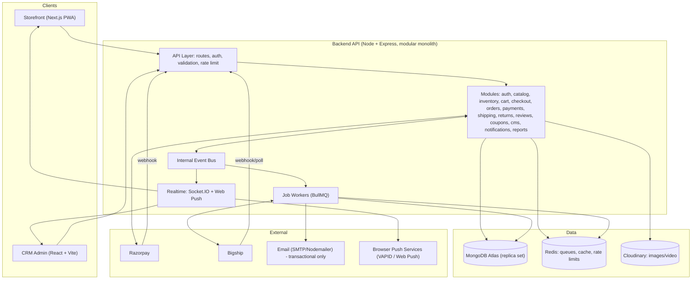
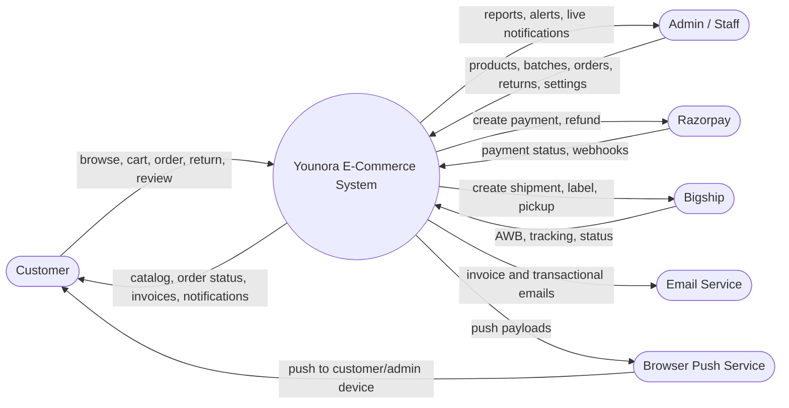
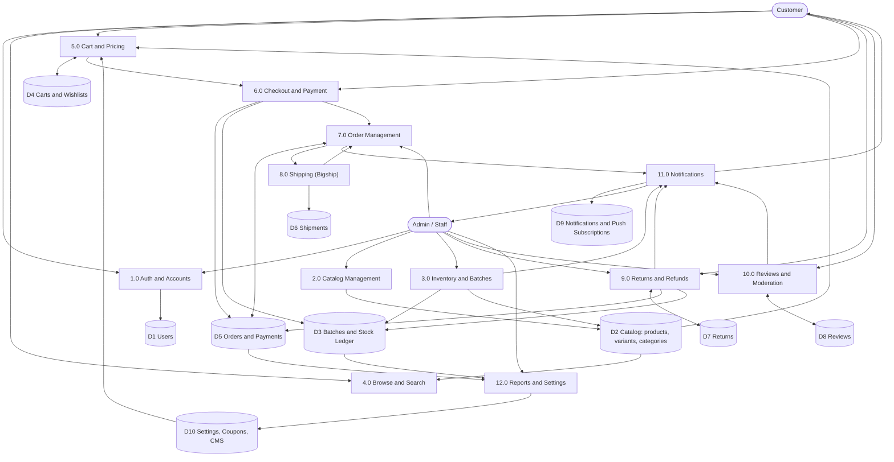
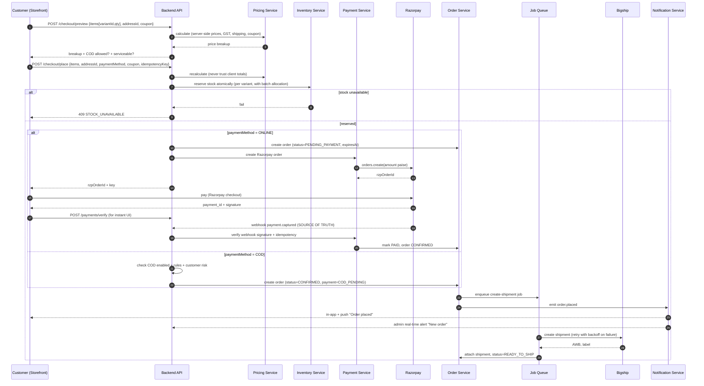
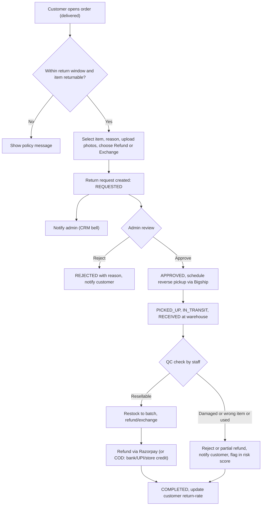
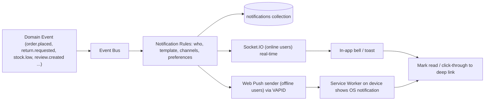

# YOUNORA LUXURY FASHION — E-Commerce Platform
## Master Project Plan, Architecture & Phase-Wise Build Guide

| | |
|---|---|
| **Project** | Younora Luxury Fashion — own-brand e-commerce (Storefront + CRM) |
| **Stack** | MERN (MongoDB, Express, React / Next.js, Node.js) |
| **Doc version** | 1.0 — 4 Nov 2026 (pre-client-meeting draft) |
| **Build order** | **Backend first (fully tested) → CRM frontend → Storefront frontend** |
| **Working style** | Phase-wise, one phase at a time, human review + test gate before the next phase |
| **AI tooling** | Antigravity AI (agent-assisted coding, controlled by the developer) |

> **How to use this file:** Keep it in the repo root as `docs/PLAN.md`. Before each Antigravity session, give the agent (1) Section 3 (Engineering rules), (2) the single phase you are working on, and (3) the relevant data-model/API sections. **Never ask it to build more than one phase at a time.**
>
> Items marked **`[CONFIRM]`** are decisions to finalize in the client meeting. Items marked **`[VERIFY]`** must be checked against the third-party's current official docs before coding (Bigship, Razorpay, Web Push, etc.).

---

## TABLE OF CONTENTS

1. [Project Overview & Goals](#1-project-overview--goals)
2. [Scope: Features Master List](#2-scope-features-master-list)
3. [Engineering Rules (give these to the AI agent every session)](#3-engineering-rules)
4. [Brand & Design System (from the logo)](#4-brand--design-system)
5. [System Architecture](#5-system-architecture)
6. [Data Flow Diagrams (DFD)](#6-data-flow-diagrams-dfd)
7. [Database Design](#7-database-design)
8. [Folder Structure](#8-folder-structure)
9. [Reusability Strategy (from the old Green Tree backend)](#9-reusability-strategy)
10. [Core Business Logic Specs](#10-core-business-logic-specs)
11. [In-House Notification System](#11-in-house-notification-system)
12. [Bigship Integration Design](#12-bigship-integration-design)
13. [Payments Design (Razorpay + COD)](#13-payments-design-razorpay--cod)
14. [API Surface](#14-api-surface)
15. [Phase Plan — BACKEND](#15-phase-plan--backend)
16. [Phase Plan — FRONTEND](#16-phase-plan--frontend)
17. [Testing Strategy](#17-testing-strategy)
18. [Security Checklist](#18-security-checklist)
19. [Deployment, DevOps & Environments](#19-deployment-devops--environments)
20. [Git Workflow & Definition of Done](#20-git-workflow--definition-of-done)
21. [Antigravity AI Working Protocol](#21-antigravity-ai-working-protocol)
22. [Client Meeting Question Bank](#22-client-meeting-question-bank)
23. [Risks & Mitigations](#23-risks--mitigations)
24. [Future Roadmap / Add-On Ideas](#24-future-roadmap--add-on-ideas)
25. [Decision Log & Change Log](#25-decision-log--change-log)

---

## 1. Project Overview & Goals

### 1.1 Background
The client previously sold garments on Meesho. The main pain point was **unjustified product returns** with no valid reason. He now wants his **own platform** to sell under the brand **Younora Luxury Fashion**, with full control over catalog, pricing, returns policy, and customers.

### 1.2 Product vision
A premium, fast, trustworthy fashion store (Flipkart/Meesho-style functionality, but simpler and more luxurious) with a powerful CRM that gives the owner control over products, batches, orders, returns, and reviews.

### 1.3 Business goals
| # | Goal | How the platform supports it |
|---|------|------------------------------|
| G1 | Reduce fake/unjustified returns | Structured return workflow, reason + photo proof, packing proof, QC on receipt, customer risk score, category-wise return rules |
| G2 | Full control of catalog | Variant-based products (color × size), per-variant price & stock, bulk upload |
| G3 | Traceability | Unique **batch number** per product/lot, shown on invoice and CRM |
| G4 | Reliable fulfillment | Bigship integration with retry, label, tracking, status sync |
| G5 | Flexible payments | Razorpay online + COD with admin ON/OFF switch and rules |
| G6 | Trust & social proof | Verified-buyer reviews with admin moderation (hide/show/reply) |
| G7 | Engagement without paid messaging | **In-house** push + in-app notifications (no SMS/WhatsApp dependency) |
| G8 | Premium brand experience | Luxury design system built from the Younora logo |

### 1.4 Users & roles
| Role | Surface | Capabilities |
|------|---------|--------------|
| **Customer** | Storefront | Browse, search, wishlist, cart, checkout, track orders, return/exchange, review, notifications |
| **Guest** | Storefront | Browse, cart; login/signup at checkout `[CONFIRM guest checkout]` |
| **Super Admin (Owner)** | CRM | Everything incl. staff, settings, payments, COD toggle |
| **Staff** | CRM | Permission-based (e.g., products only, orders only, returns only) |

### 1.5 Out of scope for v1 (listed in roadmap)
Mobile native app, multi-vendor marketplace, multi-warehouse, multi-language, loyalty points, ERP/accounting sync.

---

## 2. Scope: Features Master List

### 2.1 CRM (Admin) features
**Dashboard**
- Today/7d/30d sales, orders by status, revenue, AOV, top products, top categories, low-stock alerts, pending returns, pending reviews, COD vs prepaid split, return rate.

**Catalog**
- Audience (Men / Women / Kids), Category, Sub-category (3-level tree), attributes (fabric, fit, pattern, occasion, sleeve, neck, etc.)
- Product create/edit with: name, description, brand, material, care instructions, country of origin, HSN, GST%, size chart, return policy, tags, SEO fields, status (draft/active/hidden), images per color, video (optional)
- Variants: color × size with SKU, barcode, MRP, selling price, cost price, stock, low-stock threshold, weight/dimensions (for Bigship)
- Bulk import/export via Excel/CSV, duplicate product, bulk status/price update
- Size chart templates (reusable per category)

**Inventory & Batches**
- Unique **batch number** per product/lot (auto-generated + editable `[CONFIRM]`)
- Receive stock into batch (supplier, qty, cost, manufacture date)
- Stock movement ledger (every change audited)
- Low-stock & out-of-stock reports, batch-wise stock & sales report

**Orders**
- List/filter/search, order detail, change status, manual order (phone/WhatsApp orders), invoice PDF (with batch no.), packing slip, shipping label, retry shipment, cancel, notes/timeline
- COD confirmation status, packing proof upload

**Shipping (Bigship)**
- Serviceability by pincode, shipment creation, AWB, label, pickup request, tracking sync, NDR/RTO visibility, courier & rate display

**Payments**
- Razorpay settings status, **COD ON/OFF toggle**, COD rules (min/max order value, pincode block-list, COD fee), refund management

**Returns Desk**
- Return/exchange requests with reason + photos, approve/reject (with reason), pickup scheduling (Bigship reverse), QC result (resellable/damaged/wrong item), refund (full/partial), restock, return analytics by reason/batch/customer

**Reviews**
- List all, filter (rating, product, status), **hide/show**, delete, admin reply, mark as verified/unverified, reported reviews, banned-word auto-hide

**Customers**
- List, order history, return rate, **risk score/flag**, block/unblock, COD restriction per customer, notes

**Marketing/CMS**
- Banners (home slider), homepage sections/collections, coupons (percent/flat, min cart, category/product scope, usage limits, expiry), announcement bar, static pages (About, Policies, FAQs)

**Settings**
- Store info, GST details, invoice settings (prefix, footer), shipping settings, return policy defaults, tax slabs, notification preferences, staff & roles

**Notifications (CRM side)**
- Real-time bell: new order, payment failed, low stock, return requested, new review, shipment failed

### 2.2 Storefront (Customer) features
- Home (hero banners, collections, new arrivals, best sellers, audience tiles)
- Category / sub-category listing with filters (size, color, price, fabric, rating, discount, availability) + sorting + pagination/infinite scroll
- Search with suggestions
- Product page: gallery per color, color swatches, size selector (out-of-stock sizes disabled), size chart, price (MRP/discount), pincode delivery check, highlights, care, reviews & rating summary, similar products, share
- Wishlist, cart (variant-aware), coupons, price breakup (items, discount, GST, shipping, COD fee)
- Checkout: address, payment (Razorpay/COD if enabled), order summary
- Orders: list, detail, tracking timeline, invoice download (shows batch no.), cancel, **return/exchange request with photo upload**
- Reviews (verified buyers only; photos allowed)
- Account: profile, addresses, notifications
- **Push notifications + in-app notification center** (PWA)
- Policy pages, contact/enquiry form

---

## 3. Engineering Rules
*(Paste this section into Antigravity at the start of every session.)*

1. **Modular monolith.** One backend, strictly separated modules under `src/modules/<name>/`. Modules talk through **service functions** or the **event bus**, never by reaching into each other's models directly (except read-only populates).
2. **Layering:** `route → validation → controller → service → repository/model`. Controllers are thin (parse request, call service, send response). **All business logic lives in services.**
3. **Validation:** every input validated with **Zod** at route level. Never trust client-sent prices, totals, stock, discounts, or user IDs.
4. **Money:** store all money in **paise (integer)**. Convert only at the edges (UI, Razorpay uses paise natively). No floating-point math on money.
5. **Single response format:**
   ```json
   { "success": true, "message": "…", "data": {}, "meta": { "page": 1, "limit": 20, "total": 100 } }
   { "success": false, "message": "…", "code": "STOCK_UNAVAILABLE", "errors": [ { "field": "…", "message": "…" } ] }
   ```
6. **Errors:** custom `AppError(statusCode, code, message)`; one global error middleware; no `res.status(500).json(error.message)` leaks.
7. **Async:** `async/await` only; Express 5 forwards async errors natively. No unhandled promise rejections.
8. **Transactions:** use MongoDB transactions (replica set) for order placement, stock reservation, refunds.
9. **Idempotency:** payment webhooks, shipment creation, and refund calls must be idempotent (store external IDs, check before acting).
10. **Config:** all secrets/config in `.env`, loaded and validated once in `config/env.js` (fail fast if missing). No `process.env` scattered through the code.
11. **Logging:** `pino` structured logger; no `console.log` in committed code; never log secrets, OTPs, tokens, or full card/UPI data.
12. **Snapshots:** orders store a **snapshot** of product name, SKU, color, size, price, GST, batch number, image at purchase time.
13. **Soft delete** for catalog and customers (`isDeleted`, `deletedAt`); hard delete only for temp data.
14. **Naming:** files `kebab-case` or `camelCase` consistently (pick one: **`camelCase.js`** to match old code style is fine), Mongo collections plural, constants `UPPER_SNAKE`, enums in `shared/constants`.
15. **Tests:** each phase ships with automated tests for its critical logic (pricing, stock, auth, webhooks). No phase is "done" without passing tests.
16. **Docs:** each module has a short `README.md` (purpose, endpoints, events emitted/consumed) and endpoints are added to the Postman/OpenAPI collection.
17. **No dead code / commented-out blocks** committed (the old repo has many).
18. **Small commits**, one logical change per commit, Conventional Commits (`feat:`, `fix:`, `refactor:`, `test:`, `docs:`, `chore:`).

---

## 4. Brand & Design System

### 4.1 Logo analysis (Younora — "Luxury Fashion")
The logo is a **gold elegant serif wordmark with calligraphic swashes**, an **orange-amber silk drape**, a **stylized woman with a wide-brim hat**, and **thin gold arcs**, all on a **deep black/espresso silk background**. Mood: *luxurious, feminine, warm, premium, evening-wear*.

### 4.2 Color palette

#### Brand colors (sampled from the logo)
| Token | Hex | Usage |
|-------|-----|-------|
| `--ynr-onyx` | `#0B0705` | Primary dark background, footer, hero overlays |
| `--ynr-espresso` | `#1A100B` | Dark surfaces, CRM sidebar, cards on dark |
| `--ynr-cocoa` | `#2C1B11` | Elevated dark surfaces, hover on dark |
| `--ynr-gold-300` | `#F2CF85` | Highlights, gold gradient light end |
| `--ynr-gold-500` | `#D9A441` | **Primary brand/accent gold** — buttons, links, icons, borders |
| `--ynr-gold-700` | `#B07D2A` | Gold hover/pressed, gold text on light backgrounds |
| `--ynr-amber-500` | `#E8731A` | **Secondary accent (silk orange)** — badges, sale tags, CTA highlights |
| `--ynr-amber-700` | `#B8470A` | Amber pressed/darker accents |
| `--ynr-ivory` | `#F8F1E4` | Light page background (storefront), CRM content bg |
| `--ynr-cream` | `#EFE4D0` | Light surface/section alternation |
| `--ynr-sand` | `#E7DCC8` | Borders/dividers on light |
| `--ynr-white` | `#FFFFFF` | Cards on light |

#### Text colors
| Token | Hex | Usage |
|-------|-----|-------|
| `--text-on-dark` | `#F8F1E4` | Primary text on dark |
| `--text-muted-on-dark` | `#BFAE98` | Secondary text on dark |
| `--text-on-light` | `#1A100B` | Primary text on light |
| `--text-muted-on-light` | `#6B5A4B` | Secondary text on light |

#### Semantic colors (harmonized with the palette)
| Token | Hex | Usage |
|-------|-----|-------|
| `--success` | `#2E7D4F` | Delivered, paid, in-stock |
| `--warning` | `#D98E04` | Low stock, pending |
| `--danger` | `#B3261E` | Failed, cancelled, out of stock, delete |
| `--info` | `#2F6F8F` | Informational, shipped |

#### Gradients
```css
--gradient-gold: linear-gradient(135deg, #F2CF85 0%, #D9A441 45%, #B07D2A 100%);
--gradient-silk: linear-gradient(135deg, #E8731A 0%, #B8470A 100%);
--gradient-dark: linear-gradient(180deg, #1A100B 0%, #0B0705 100%);
```

### 4.3 Where to use dark vs light
| Surface | Theme |
|---------|-------|
| **Storefront** | Hybrid: **ivory** content areas with **onyx** header/footer/hero; gold accents; amber for sale/discount badges |
| **CRM** | **Espresso sidebar + topbar**, **ivory content area**, white cards, gold active states; optional full dark-mode toggle later |

> **Accessibility:** gold `#D9A441` on onyx passes contrast; gold on ivory does **not** for small text — use `--ynr-gold-700` (`#B07D2A`) or onyx text on light backgrounds. Verify with a contrast checker (WCAG AA ≥ 4.5:1 for body text).

### 4.4 Typography
| Role | Font (Google Fonts) | Notes |
|------|---------------------|-------|
| Display / headings (storefront) | **Cormorant Garamond** (or Playfair Display) | Matches the logo's elegant serif |
| Body / UI | **Inter** or **Jost** | Clean, readable at small sizes |
| CRM headings | **Inter** (600/700) | Functional clarity for data-heavy screens |
| Prices/numerals | Inter tabular numerals | Aligned columns |

Scale (rem): `0.75 / 0.875 / 1 / 1.125 / 1.25 / 1.5 / 2 / 2.5 / 3.25`.

### 4.5 UI tokens
- **Radius:** `4px` (inputs/buttons — keep sharper = more luxurious), `8px` (cards), `999px` (pills/badges)
- **Spacing:** 4px grid (`4, 8, 12, 16, 24, 32, 48, 64, 96`)
- **Shadows:** soft warm shadows `0 8px 30px rgba(26,16,11,0.12)`
- **Borders:** 1px `--ynr-sand`; gold 1px hairlines for luxury accents
- **Motion:** 200–300ms ease-out; subtle fades/slides; respect `prefers-reduced-motion`
- **Buttons:** Primary = gold gradient + onyx text; Secondary = onyx outline/gold border; Danger = danger color; Ghost = text only
- **Badges:** Sale = amber; New = gold outline; Low stock = warning; Out of stock = muted grey

### 4.6 Logo usage
- Provide: full logo (dark bg), monochrome gold, monochrome onyx (for light backgrounds), icon-only mark (hat-lady/"Y"), favicon (32/180/512), OG-image.
- Minimum clear space = height of the "Y". Never place on busy/bright backgrounds. Get **SVG** from the client/designer (the shared file is a raster JPEG; extract at higher resolution or vectorize).

---

## 5. System Architecture

### 5.1 High-level architecture


### 5.2 Technology decisions
| Layer | Choice | Reason |
|-------|--------|--------|
| Runtime | Node.js 20 LTS+ | Stable, matches old codebase |
| Framework | Express 5 | Already used; native async error handling |
| DB | MongoDB Atlas + Mongoose 8 | Flexible variants; transactions need replica set (Atlas provides) |
| Validation | Zod | Schema reuse in frontend via shared package |
| Auth | JWT access (short) + refresh token (httpOnly cookie, rotated) | Secure, SPA-friendly |
| Password | bcrypt (or argon2) | Existing bcrypt usage |
| Queue/Jobs | BullMQ + Redis | Retries, delays, scheduling (shipment retry, expiry, reminders). *Fallback if Redis is unwanted: DB-backed job collection + node-cron.* |
| Realtime | Socket.IO (CRM live bell + storefront in-app) | In-house, no paid service |
| Push | `web-push` (VAPID) + service worker | In-house browser push, no third-party SaaS `[VERIFY]` |
| Media | Cloudinary (existing) | Transformations, CDN |
| Payments | Razorpay | Required |
| Shipping | Bigship via adapter | Required |
| PDF | `pdfkit` (light) or Puppeteer (HTML template) | Invoice/packing slip/label |
| Excel | `exceljs` or `xlsx` | Bulk import/export |
| Logging | `pino` + `pino-http` | Structured logs |
| Security | `helmet`, `cors` (whitelist), `express-rate-limit`, `express-mongo-sanitize`, `hpp` | Hardening |
| Tests | Jest + Supertest + `mongodb-memory-server` (replica set mode) | Fast, isolated |
| CRM FE | React 18 + Vite + React Router + TanStack Query + Zustand/Redux Toolkit + React Hook Form + Zod + TanStack Table | Data-heavy admin |
| Storefront FE | **Next.js (App Router)** + TanStack Query | SEO, speed, PWA for push |
| Styling | Tailwind CSS with the design tokens from §4 | Fast, consistent |
| API docs | OpenAPI (Swagger) + Postman collection | Handoff to frontend |

> **Why Next.js for storefront:** fashion shoppers arrive from Google/Instagram; server-rendered product & category pages rank and load faster. The CRM stays a plain React SPA since SEO is irrelevant there.

### 5.3 Environments
`local` → `staging` (client UAT, Razorpay test mode, Bigship sandbox) → `production`.

---

## 6. Data Flow Diagrams (DFD)

### 6.1 DFD Level 0 — Context diagram


### 6.2 DFD Level 1 — Main processes


### 6.3 DFD Level 2 — Checkout & Payment (most critical flow)


### 6.4 Return & Refund flow


### 6.5 Notification flow


---

## 7. Database Design

> Money fields are **integers in paise**. All collections have `createdAt/updatedAt`. Indexes listed per collection are required.

### 7.1 ER overview
```mermaid
erDiagram
  CUSTOMER ||--o{ ADDRESS : has
  CUSTOMER ||--o{ ORDER : places
  CUSTOMER ||--o{ REVIEW : writes
  CUSTOMER ||--o{ WISHLIST_ITEM : saves
  CUSTOMER ||--|| CART : owns
  CUSTOMER ||--o{ PUSH_SUBSCRIPTION : registers
  ADMIN_USER ||--o{ AUDIT_LOG : performs
  AUDIENCE ||--o{ CATEGORY : contains
  CATEGORY ||--o{ SUBCATEGORY : contains
  SUBCATEGORY ||--o{ PRODUCT : classifies
  PRODUCT ||--o{ VARIANT : has
  PRODUCT ||--o{ REVIEW : receives
  VARIANT ||--o{ BATCH : stocked_in
  BATCH ||--o{ STOCK_MOVEMENT : logs
  ORDER ||--|{ ORDER_ITEM : contains
  ORDER ||--o| SHIPMENT : fulfilled_by
  ORDER ||--o{ PAYMENT : paid_by
  ORDER ||--o{ RETURN_REQUEST : may_have
  ORDER_ITEM }o--|| VARIANT : snapshot_of
  ORDER_ITEM }o--|| BATCH : allocated_from
  RETURN_REQUEST ||--o| SHIPMENT : reverse_pickup
  NOTIFICATION }o--|| CUSTOMER : to
  NOTIFICATION }o--|| ADMIN_USER : to
```

### 7.2 Collections (field-level spec)

#### `admin_users` (CRM staff — separate from customers)
```
name, email (unique), passwordHash, role: SUPER_ADMIN|STAFF,
permissions: [ "products.read","products.write","orders.read","orders.write",
               "returns.manage","reviews.manage","customers.read","settings.manage", ... ],
isActive, lastLoginAt, refreshTokens[]
```

#### `customers`
```
name, email (unique sparse), phone (unique sparse), passwordHash?, authProviders[],
gender?, dob?, isBlocked, blockReason?,
codRestricted (bool),
stats: { totalOrders, deliveredOrders, cancelledOrders, returnedOrders, rtoOrders, returnRate },
riskScore (0–100), riskFlag: NONE|WATCH|HIGH,
emailVerified, phoneVerified, notificationPrefs: { orders, offers, returns, reviews }
```

#### `addresses`
```
customer, name, phone, line1, line2, landmark, city, state, pincode, country="IN",
type: HOME|WORK|OTHER, isDefault
```

#### `audiences` / `categories` / `subcategories`
```
audience:    name (Men|Women|Kids), slug, image, sortOrder, isActive
category:    audience, name, slug, image, sortOrder, isActive, defaultSizeChart?, returnPolicy?
subcategory: category, name, slug, image, sortOrder, isActive
```
> Replace the old string-based `category/subCategory` with **ObjectId references**.

#### `attributes` (optional master data for filters)
```
type: COLOR|SIZE|FABRIC|FIT|PATTERN|OCCASION|SLEEVE|NECK ..., name, value (hex for color), sortOrder
```

#### `size_charts`
```
name, category?, unit: INCH|CM, columns: ["Chest","Waist","Length"...],
rows: [ { size: "M", values: { Chest: 38, Waist: 32, Length: 27 } } ]
```

#### `products` (parent)
```
name, slug (unique), description, highlights[],
audience, category, subcategory, brand="Younora",
material/fabric, fit, pattern, occasion, careInstructions, countryOfOrigin,
hsnCode, gstPercent, sizeChart,
returnPolicy: { returnable: bool, returnWindowDays, exchangeOnly: bool, reasonRequired: true },
tags[], seo: { title, description, keywords },
colors: [ { name, hex, images: [ {url, publicId, alt, sortOrder} ], video? } ],
priceRange: { minSelling, maxSelling, minMrp, maxMrp },   // denormalized from variants
rating: { avg, count, breakdown: {1..5} },                // denormalized from reviews
totalStock (denormalized),
status: DRAFT|ACTIVE|HIDDEN, isFeatured, isNewArrival, isBestSeller,
isDeleted
```
Indexes: `slug`, `{audience,category,subcategory,status}`, text index on `name,tags,description`, `{status,createdAt}`.

#### `variants` (the sellable unit: color × size)
```
product, sku (unique), barcode?,
color: { name, hex }, size: "S|M|L|XL|...|Free" ,
mrp, sellingPrice, costPrice,                // paise; price can differ per size/color
stock (available), reservedStock, lowStockThreshold,
weightGrams, lengthCm, breadthCm, heightCm,  // for Bigship
isActive
```
Indexes: `sku`, `{product, color.name, size}` unique, `{product,isActive}`.

#### `batches` (unique batch tracking) 
```
batchNo (unique, e.g. "YNR-2611-WMN-0001"),
product, variant?,                      // per-variant lot or product-level lot [CONFIRM]
supplier { name, contact, invoiceNo }, manufacturedOn?, receivedOn,
qtyReceived, qtyAvailable, qtyReserved, qtySold, qtyReturnedResellable, qtyDamaged,
costPerUnit, notes, status: ACTIVE|EXHAUSTED|QUARANTINED
```
Allocation policy `[CONFIRM]`: **FIFO** (oldest batch first) by default.

#### `stock_movements` (immutable ledger)
```
variant, batch, type: RECEIVE|RESERVE|RELEASE|SALE|RETURN_RESTOCK|DAMAGE|ADJUST|CANCEL,
qty (+/-), balanceAfter, refType (ORDER|RETURN|MANUAL), refId, actor, note
```

#### `carts`
```
customer, items: [ { variant, qty, addedAt } ], couponCode?, updatedAt, abandonedNotifiedAt?
```
> Prices are NOT stored in cart; always recomputed from the variant.

#### `wishlists`
```
customer, product, addedAt     (unique {customer, product})
```

#### `orders`
```
orderNo (e.g. "YNR-2611-000123"), invoiceNo (assigned on confirm/ship),
customer, 
items: [ OrderItem snapshot: {
   product, variant, name, sku, color, size, image,
   batchNo, batch (ref),
   mrp, sellingPrice, qty, discount, taxableValue, gstPercent, gstAmount, lineTotal, hsnCode,
   returnPolicySnapshot, itemStatus: ACTIVE|CANCELLED|RETURN_REQUESTED|RETURNED|EXCHANGED
}],
shippingAddress {...snapshot}, billingAddress {...snapshot}, customerSnapshot {name, email, phone},
pricing: { itemsTotal, discount, couponCode, couponDiscount, taxableAmount, gstTotal(cgst/sgst/igst), shippingFee, codFee, grandTotal, roundOff },
payment: { method: ONLINE|COD, status: PENDING|PAID|FAILED|REFUNDED|PARTIAL_REFUND|COD_PENDING|COD_COLLECTED, paidAt },
status: PENDING_PAYMENT|CONFIRMED|PACKED|READY_TO_SHIP|SHIPPED|OUT_FOR_DELIVERY|DELIVERED|CANCELLED|RTO|COMPLETED,
statusHistory: [ { status, at, by, note } ],
codConfirmation: { required, status: PENDING|CONFIRMED|FAILED, at },
packingProof: [ { url, type: PHOTO|VIDEO, at, by } ],
shipment (ref), expiresAt (for PENDING_PAYMENT), idempotencyKey (unique), source: WEB|ADMIN,
notes: [ { by, text, at } ]
```
Indexes: `orderNo`, `customer+createdAt`, `status+createdAt`, `idempotencyKey`, `payment.status`.

#### `payments`
```
order, method, provider: RAZORPAY|COD, amount, currency,
razorpayOrderId, razorpayPaymentId, razorpaySignature,
status: CREATED|AUTHORIZED|CAPTURED|FAILED|REFUNDED|PARTIAL_REFUND,
refunds: [ { razorpayRefundId, amount, status, reason, at, return? } ],
rawWebhookEvents: [ { eventId, type, receivedAt } ]       // idempotency
```
Indexes: unique sparse on `razorpayPaymentId`, `razorpayOrderId`.

#### `shipments`
```
order, type: FORWARD|REVERSE, provider: "BIGSHIP",
bigshipOrderId, awb, courier, courierId?, labelUrl, manifestUrl, trackingUrl,
status (normalized): CREATED|PICKUP_SCHEDULED|PICKED_UP|IN_TRANSIT|OUT_FOR_DELIVERY|DELIVERED|NDR|RTO_INITIATED|RTO_DELIVERED|CANCELLED|FAILED,
rawStatus, trackingEvents: [ { status, location, at, raw } ],
weight, dimensions, charges { forward, cod, total },
attempts, lastError, lastSyncedAt, rawResponse
```

#### `return_requests`
```
returnNo, order, customer, type: RETURN|EXCHANGE,
items: [ { orderItem, qty, reason: WRONG_SIZE|DEFECTIVE|DAMAGED|WRONG_ITEM|NOT_AS_DESCRIBED|OTHER, comment, photos[], exchangeVariant? } ],
status: REQUESTED|APPROVED|REJECTED|PICKUP_SCHEDULED|PICKED_UP|RECEIVED|QC_PASSED|QC_FAILED|REFUNDED|EXCHANGE_SHIPPED|COMPLETED|CANCELLED,
decision { by, at, note, rejectReason },
qc { by, at, result: RESELLABLE|DAMAGED|USED|WRONG_ITEM, photos[], note },
refund { method: ORIGINAL|BANK|UPI|STORE_CREDIT, amount, status, razorpayRefundId?, bankDetails? (encrypted) },
reverseShipment (ref), statusHistory[]
```

#### `reviews`
```
product, variant?, customer, order (verified purchase), rating(1–5), title, comment, photos[],
fitFeedback: SMALL|TRUE_TO_SIZE|LARGE (optional, feeds size recommendation),
status: VISIBLE|HIDDEN|PENDING, hiddenReason?, isVerifiedPurchase,
adminReply { text, by, at }, reportedCount, helpfulCount
```
Unique: `{customer, product, order}`.

#### `coupons`
```
code (unique), type: PERCENT|FLAT, value, maxDiscount?, minCartValue, 
scope: ALL|CATEGORY|PRODUCT, scopeIds[], usageLimit, perUserLimit, usedCount,
startsAt, expiresAt, isActive, firstOrderOnly?, paymentMethodRestriction?
```

#### `banners` / `cms_pages` / `home_sections`
```
banner: image(desktop/mobile), title, link, position, sortOrder, startsAt, endsAt, isActive
cms_page: slug, title, content (rich/markdown), isActive
home_section: type: COLLECTION|PRODUCT_RAIL|BANNER|CATEGORY_TILES, title, config, sortOrder, isActive
```

#### `settings` (single document / key-value)
```
store { name, email, phone, address, gstin, logo },
payments { codEnabled, codMinOrder, codMaxOrder, codFee, codBlockedPincodes[], onlineEnabled },
shipping { freeShippingAbove, flatFee, pickupAddress, defaultPackaging dims },
returns { defaultWindowDays, allowExchange, requirePhotoProof },
tax { defaultGstSlabs, pricesInclusiveOfTax },
invoice { prefix, footerNote, termsText, nextSequence },
notifications { adminEvents enabled map }
```

#### `notifications`
```
recipientType: CUSTOMER|ADMIN, recipient (id), 
type (ORDER_PLACED, ORDER_SHIPPED, ... ), title, body, icon?, image?, deepLink,
data {...}, channels: { inApp: bool, push: bool }, 
readAt?, pushStatus: SENT|FAILED|SKIPPED, createdAt
```
TTL index to purge after e.g. 90 days.

#### `push_subscriptions`
```
recipientType, recipient, endpoint (unique), keys { p256dh, auth }, userAgent, 
isActive, lastSuccessAt, failureCount
```

#### `audit_logs`
```
actor (admin), action ("product.update", "order.status", "cod.toggle"...), entity, entityId, before, after, ip, at
```

#### `counters`
```
key ("order-2611", "invoice-2526", "batch-2611"), seq    // atomic $inc for numbering
```

---

## 8. Folder Structure

### 8.1 Repository layout (monorepo, npm workspaces)
```
younora/
├─ apps/
│  ├─ backend/                 # Node + Express API  (BUILT FIRST)
│  ├─ crm/                     # React + Vite admin  (built second)
│  └─ storefront/              # Next.js customer site (built third)
├─ packages/
│  ├─ shared-constants/        # enums: order statuses, roles, permissions, return reasons
│  ├─ shared-validation/       # Zod schemas reused by backend + frontends
│  └─ ui-tokens/               # design tokens (colors, fonts) + tailwind preset
├─ docs/
│  ├─ PLAN.md                  # this file
│  ├─ api/                     # OpenAPI spec + Postman collection
│  ├─ decisions/               # ADRs (architecture decision records)
│  └─ phases/                  # per-phase notes, test reports, sign-offs
├─ .github/workflows/          # CI (lint, test, build)
├─ .editorconfig, .gitignore, .prettierrc, eslint.config.js
├─ package.json                # workspaces
└─ README.md
```
> *Alternative:* three separate repos. Monorepo is recommended so shared enums/validation never drift. Backend must still run standalone (`npm run dev -w apps/backend`).

### 8.2 Backend structure (`apps/backend`)
```
apps/backend/
├─ src/
│  ├─ server.js                      # bootstrap: connect DB/Redis, start HTTP + Socket.IO
│  ├─ app.js                         # express app: middleware, routes, error handler
│  ├─ config/
│  │  ├─ env.js                      # zod-validated env
│  │  ├─ db.js                       # mongoose connection
│  │  ├─ redis.js
│  │  ├─ cloudinary.js
│  │  ├─ razorpay.js
│  │  └─ webpush.js                  # VAPID setup
│  ├─ core/
│  │  ├─ errors/                     # AppError, error codes, error middleware
│  │  ├─ http/                       # response helpers, pagination, query-builder
│  │  ├─ middleware/                 # authenticate, authorize, permission, validate, rateLimit, upload, idempotency
│  │  ├─ events/                     # eventBus.js, event names (events.js)
│  │  ├─ queue/                      # bullmq setup, queue names, worker registry
│  │  ├─ logger.js
│  │  ├─ utils/                      # money.js, slugify, counters, dates, crypto
│  │  └─ constants/                  # re-export shared-constants
│  ├─ modules/
│  │  ├─ auth/                       # admin + customer auth, refresh tokens, OTP/email verify, password reset
│  │  ├─ users/                      # admin-users (staff/roles), customers, addresses
│  │  ├─ catalog/
│  │  │  ├─ audience/ category/ subcategory/ attribute/ sizeChart/
│  │  │  ├─ product/ variant/
│  │  │  └─ catalog.routes.js
│  │  ├─ inventory/                  # batches, stock movements, allocation, bulk import
│  │  ├─ storefront/                 # public read APIs: listing, filters, search, home
│  │  ├─ wishlist/
│  │  ├─ cart/
│  │  ├─ pricing/                    # pricing engine (GST, discount, shipping, COD fee)
│  │  ├─ coupons/
│  │  ├─ checkout/                   # preview + place order orchestration
│  │  ├─ orders/                     # order lifecycle, invoice, packing slip
│  │  ├─ payments/                   # razorpay service, webhooks, refunds, COD rules
│  │  ├─ shipping/
│  │  │  ├─ shipping.service.js      # provider-agnostic
│  │  │  ├─ providers/
│  │  │  │  ├─ provider.interface.js
│  │  │  │  └─ bigship/              # client, mapper, webhook handler
│  │  │  └─ jobs/                    # createShipment, syncTracking, retry
│  │  ├─ returns/                    # return/exchange, QC, refunds, risk scoring
│  │  ├─ reviews/
│  │  ├─ notifications/              # templates, rules, in-app, socket, web-push
│  │  ├─ cms/                        # banners, home sections, static pages
│  │  ├─ reports/                    # dashboard aggregations, exports
│  │  ├─ settings/
│  │  ├─ audit/
│  │  └─ enquiry/                    # contact form
│  ├─ jobs/                          # cron registrations (expire unpaid, abandoned cart, tracking sync)
│  ├─ docs/                          # swagger setup
│  └─ seed/                          # seed scripts (admin, categories, sample products)
├─ tests/
│  ├─ unit/        # pricing, money, allocation, risk score
│  ├─ integration/ # supertest per module
│  ├─ e2e/         # full checkout flow
│  └─ helpers/     # test db, factories, mock razorpay/bigship
├─ .env.example
├─ package.json
└─ README.md
```

**Inside each module (consistent template):**
```
modules/<name>/
├─ <name>.model.js
├─ <name>.validation.js     # zod schemas
├─ <name>.routes.js
├─ <name>.controller.js
├─ <name>.service.js
├─ <name>.events.js         # events emitted / listeners
├─ <name>.test.js (or in /tests)
└─ README.md
```

### 8.3 CRM structure (`apps/crm`)
```
apps/crm/
├─ src/
│  ├─ main.jsx, App.jsx
│  ├─ app/            # router, providers (query, auth, theme, socket), guards
│  ├─ assets/         # logo, icons
│  ├─ components/
│  │  ├─ ui/          # Button, Input, Select, Modal, Drawer, Badge, Tabs, Toast, Skeleton, EmptyState
│  │  ├─ layout/      # Sidebar, Topbar, PageHeader, NotificationBell
│  │  ├─ data/        # DataTable, FilterBar, Pagination, StatCard, Charts
│  │  └─ form/        # FormField wrappers, ImageUploader, RichText, VariantMatrixEditor
│  ├─ features/
│  │  ├─ auth/ dashboard/ catalog/ inventory/ orders/ shipping/
│  │  ├─ returns/ reviews/ customers/ coupons/ cms/ settings/ staff/ notifications/ reports/
│  │  └─ (each: pages/, components/, api.js, hooks.js, schema.js)
│  ├─ lib/            # axios client (interceptors, refresh), socket, formatters (money, date)
│  ├─ store/          # auth, ui state
│  └─ styles/         # tailwind, tokens
└─ vite.config.js
```

### 8.4 Storefront structure (`apps/storefront`, Next.js App Router)
```
apps/storefront/
├─ src/
│  ├─ app/
│  │  ├─ (shop)/ page.jsx (home), [audience]/page.jsx, c/[category]/[sub]/page.jsx,
│  │  │          p/[slug]/page.jsx, search/page.jsx, wishlist/page.jsx
│  │  ├─ (checkout)/ cart/page.jsx, checkout/page.jsx, order-success/[id]/page.jsx
│  │  ├─ (account)/ account/..., orders/[id]/..., returns/..., notifications/page.jsx
│  │  ├─ (auth)/ login, register, forgot-password
│  │  ├─ (content)/ pages/[slug]
│  │  ├─ sitemap.js, robots.js, manifest.js
│  ├─ components/ ui/, layout/ (Header, Footer, MegaMenu, MobileNav), product/ (Card, Gallery, ColorSwatch, SizeSelector, SizeChartModal, PincodeCheck), cart/, checkout/, review/, notification/
│  ├─ features/  (api + hooks per domain)
│  ├─ lib/ api client, seo helpers, formatters, push (service worker registration)
│  └─ styles/
├─ public/ (sw.js service worker, icons, manifest, logo)
```

---

## 9. Reusability Strategy

### 9.1 From the old "Green Tree" backend
| Old asset | Decision | What to change |
|-----------|----------|----------------|
| `config/cloudinary.js`, `upload.controller.js`, multer | **Reuse (refactor)** | Move to `config/` + `core/middleware/upload`; add file type/size limits, folder per entity |
| `middleware/authorization.js` (`authenticate`, `authorize`) | **Reuse concept, rewrite** | Return 401/403 properly (old returns 400); add permission-based check; refresh-token flow; separate admin/customer tokens |
| `register.*` (auth/OTP/forgot password) | **Reuse logic, split** | Split into `admin_users` and `customers`; hash OTPs; expiry + attempt limits; remove SMS dependency (decide email/OTP provider `[CONFIRM]`) |
| `payment.controller.js` (Razorpay order + signature verify) | **Reuse core** | Add server-side amount calc, webhook handler, idempotency, payments collection |
| `order.controller.js` (53 KB) | **Rewrite** | Break into checkout/orders/payments/shipping services; atomic stock; no inline courier call |
| Cancel + refund via Razorpay | **Reuse idea** | Move into returns/payments services with partial refunds & ledger |
| `cod.models.js` (COD toggle) | **Reuse** | Move into `settings.payments`, add rules |
| `coupon.*` | **Extend** | Add percent/flat, limits, expiry, scope |
| `category/subCategory/mainCategory` | **Reuse structure** | Convert to Audience → Category → Subcategory with ObjectId refs |
| `address.*`, `wishlist.*`, `cart.*` | **Reuse, adapt** | Cart/wishlist become variant-aware |
| `slide.*`, `title.*` | **Reuse → CMS banners/sections** | Rename & extend |
| `enquiry.*` | **Reuse** | Add status + admin reply |
| `staff.*` | **Reuse → admin_users + permissions** | |
| `shippingPrice` (by pincode) | **Reuse as fallback** | Primary rates from Bigship; keep manual override table |
| `tax.*` | **Replace** | HSN/GST per product + settings |
| `upload.controller` (Excel) | **Reuse idea** | Variant-aware bulk import with validation report |
| `services/whatsapp.service.js`, Fast2SMS code, birthday/anniversary cron, abandoned-cart WhatsApp | **Drop / replace** | Replaced by in-house notification system |
| `roadChallan.*` | **Drop** | Nursery-specific |
| `product.models.js` | **Rewrite** | Product + Variant + Batch |
| Hard-coded `cors: *`, `console.log` everywhere, client-trusted totals | **Fix** | See §3 and §18 |

### 9.2 Cross-project reuse (design for it from day 1)
- **`packages/shared-constants`**: statuses, roles, permissions, return reasons, notification types → used by backend, CRM, storefront (no string drift).
- **`packages/shared-validation`**: Zod schemas (address, product form, review, return request) shared for FE+BE validation.
- **`packages/ui-tokens`**: colors/typography/spacing → Tailwind preset consumed by CRM and storefront.
- **Generic backend building blocks** reusable in any future project: `core/errors`, `core/http`, `core/queue`, `core/events`, `notifications` module, `shipping/providers` adapter, `audit` module.
- **Provider adapters:** `shipping/providers/*` and (optionally) `payments/providers/*` behind interfaces → switch courier/gateway without touching order logic.
- **Feature flags** via `settings` (COD, online payments, reviews moderation mode, guest checkout).

---

## 10. Core Business Logic Specs

### 10.1 Batch number
- **Format (proposed):** `YNR-<YYMM>-<AUD>-<SEQ4>` → e.g. `YNR-2611-WMN-0042`
  `AUD` = MEN/WMN/KID (or category code). Sequence from atomic `counters`.
- Unique index on `batchNo`. Admin can override with a custom unique value `[CONFIRM]`.
- **When stock is received** → create batch (or add to existing batch).
- **At order placement** → allocate units from batches (FIFO) and store `batchNo` in the `OrderItem` snapshot.
- **If an order line spans two batches** → split into two allocation entries; invoice shows each batch `[CONFIRM display style]`.
- **Shown in:** CRM product/inventory/order pages, packing slip, **customer invoice (per line)**, CRM dashboard batch report.
- **Returns** restock to the original batch (traceability to detect bad lots).

### 10.2 Pricing engine (single source of truth, `modules/pricing`)
Inputs: variants+qty, coupon, address (state), payment method, settings.
Steps:
1. Fetch current variant prices from DB (ignore client prices).
2. Line total = `sellingPrice × qty`.
3. Apply coupon (validate scope, min cart, limits, expiry, first-order, payment-method restriction).
4. GST per line by product `gstPercent` (`pricesInclusiveOfTax` setting decides back-calc vs add-on). Intra-state → CGST+SGST; inter-state → IGST (store GSTIN state) `[CONFIRM with CA]`.
5. Shipping fee (free above threshold or Bigship/rate-table based).
6. COD fee if COD.
7. Round-off, grand total (paise).
Return a full **breakup object** used by preview, checkout, invoice. **Unit-test this heavily.**

### 10.3 Stock reservation
- Atomic: `updateOne({_id, stock: {$gte: qty}}, {$inc: {stock: -qty, reservedStock: +qty}})`.
- COD/paid → confirm (reserved→sold). Pending online payment → reserved with `expiresAt` (e.g., 15 min); job releases expired.
- Cancel/failed → release. All movements logged in `stock_movements`.

### 10.4 Order status state machine
```
PENDING_PAYMENT → CONFIRMED → PACKED → READY_TO_SHIP → SHIPPED → OUT_FOR_DELIVERY → DELIVERED → COMPLETED
        ↓              ↓           ↓            ↓
     CANCELLED      CANCELLED   CANCELLED    (cancel via shipment cancel)
SHIPPED/OUT_FOR_DELIVERY → RTO (return to origin)
```
Only allowed transitions permitted (enforced in service); every change appended to `statusHistory` + audit + notification.

### 10.5 COD rules
Global toggle `payments.codEnabled` AND all of: order value within min/max, pincode not blocked & serviceable, customer not `codRestricted`/HIGH risk, optional COD fee. Optional **COD confirmation** step (in-app/call by staff) before dispatch `[CONFIRM]`.

### 10.6 Return abuse prevention (client's core pain point)
| Control | Detail |
|---------|--------|
| Reason mandatory | Dropdown + comment; photo required for DEFECTIVE/DAMAGED/WRONG_ITEM |
| Return window | Per category/product (e.g., 7 days from delivery) |
| Non-returnable | Product flag (e.g., innerwear, sale items) |
| Size issues | Prefer **exchange** over refund (`exchangeOnly` option) |
| Packing proof | Staff upload photo/video at packing, linked to order |
| Unboxing proof | Optional for high-value orders `[CONFIRM]` |
| QC on receipt | Resellable / damaged / used / wrong item → decides refund (full/partial/none) |
| Customer risk score | Based on return rate, RTO, COD refusals; auto flag WATCH/HIGH |
| Actions on risk | Disable COD, require prepaid, limit returns, manual review |
| Batch analytics | Return rate per batch/product/size → spot genuine quality issues vs abuse |
| Reverse pickup | Via Bigship, tracked |

**Risk score (starter formula, tunable in settings):**
`score = 40*returnRate + 30*rtoRate + 20*codRefusalRate + 10*(fastReturnFlag)` → `<30 NONE`, `30–60 WATCH`, `>60 HIGH`. Recompute on delivery/return/RTO events.

### 10.7 Reviews
- Only customers with a **DELIVERED** order containing that product may review (verified).
- Moderation mode setting: **auto-publish** or **hold for approval** `[CONFIRM]`.
- Admin: hide/show (with reason), delete, reply, filter, bulk-hide; banned-word auto-hold; report handling.
- Aggregate rating recalculated on every visibility change (only VISIBLE counted).
- Optional **fit feedback** (small/true/large) shown on the product page.

### 10.8 Invoice
- Sequential invoice number (financial-year based `INV/2526/00001`), GSTIN, HSN, CGST/SGST/IGST, **batch no. per line**, payment method, Younora branding, terms.
- PDF generated on confirmation/shipping, stored (Cloudinary or private storage), downloadable by customer & admin.

---

## 11. In-House Notification System

> **Requirement:** push notifications that are **not** SMS/WhatsApp — fully in-house.

### 11.1 Channels
| Channel | Tech | Who | Notes |
|---------|------|-----|-------|
| **In-app notification center + bell** | MongoDB `notifications` + REST + **Socket.IO** | Customers & admins | Always works, real-time when online, persistent history |
| **Browser/PWA Web Push** | `web-push` library, **VAPID keys**, service worker, `push_subscriptions` | Customers & admins | Works when tab/browser closed `[VERIFY]` |
| (Optional later) Email | Nodemailer | Invoices/password reset only | Transactional, not marketing |

> **Platform notes `[VERIFY]`:** Web Push works on Chrome/Edge/Firefox/Android; **iOS requires the site to be installed to Home Screen (PWA, iOS 16.4+)**. If a native app is built later, add FCM/APNs as another channel behind the same notification service.

### 11.2 Architecture
```
Module emits event  →  eventBus  →  notifications/listeners
   → resolve recipients + template + preferences
   → save Notification (DB)
   → if recipient online: socket.emit("notification", payload) to room user:<id>
   → if push subscription exists: enqueue push job → web-push send
       → on 404/410 response: deactivate subscription
```
- Socket rooms: `customer:<id>`, `admin:<id>`, `admin:permission:<perm>`.
- Socket auth via the same JWT.
- Deep links: `/orders/:id`, `/returns/:id`, CRM `/orders/:id`, etc.

### 11.3 Event → Notification matrix
| Event | Customer | Admin/Staff |
|-------|----------|-------------|
| `order.placed` | ✅ "Order placed" | ✅ "New order #…" |
| `payment.captured` / `payment.failed` | ✅ | ✅ (failed) |
| `order.packed/shipped/out_for_delivery/delivered` | ✅ | — |
| `order.cancelled` | ✅ | ✅ |
| `shipment.failed` | — | ✅ "Shipment creation failed — retry" |
| `shipment.ndr` / `rto` | ✅ (NDR) | ✅ |
| `return.requested` | ✅ ack | ✅ |
| `return.approved/rejected/picked/refunded` | ✅ | — |
| `stock.low` / `stock.out` | — | ✅ |
| `review.created` / `review.reported` | — | ✅ |
| `cart.abandoned` (job) | ✅ (respect prefs, rate-limited) | — |
| `wishlist.back_in_stock` / `price_drop` | ✅ | — |
| `offer.broadcast` (admin-created) | ✅ (opt-in) | — |
| `customer.high_risk` | — | ✅ |

### 11.4 Preferences & rules
- Customers can toggle categories: orders (always on for transactional), offers, returns, reviews.
- Quiet hours for marketing pushes; frequency cap (e.g., max 2 marketing pushes/day).
- Admin can send **broadcast push** (segment: all / audience / recent buyers) from CRM.
- Templates stored in code (`templates.js`) with variables; later editable from CRM.

### 11.5 Backend endpoints (summary)
`GET /notifications`, `PATCH /notifications/:id/read`, `PATCH /notifications/read-all`, `GET /notifications/unread-count`, `POST /push/subscribe`, `DELETE /push/unsubscribe`, `GET /push/public-key`, admin: `POST /admin/notifications/broadcast`.

---

## 12. Bigship Integration Design

> **`[VERIFY]` Everything below must be mapped to Bigship's current official API docs & sandbox before coding. Get API credentials, pickup/warehouse setup, and webhook availability first.**

### 12.1 Capabilities needed
| Capability | Used for |
|------------|----------|
| Auth/token | Server-side authentication (cache token, refresh before expiry) |
| Serviceability & rate check | Pincode delivery check on product page; shipping fee; COD availability |
| Warehouse/pickup address | One-time setup (store in settings) |
| Create forward shipment/order | After order confirmed |
| Courier selection/AWB assignment | Choose courier (cheapest/fastest rule) |
| Label / manifest | Print from CRM |
| Pickup request | Schedule pickup |
| Tracking | Status sync (webhook if available, else polling cron) |
| Cancel shipment | When order cancelled pre-pickup |
| Reverse pickup | Return requests |
| NDR actions | Re-attempt/RTO (if supported) |

### 12.2 Adapter pattern
```js
// shipping/providers/provider.interface.js
{
  checkServiceability({ pickupPincode, deliveryPincode, weight, cod, value }),
  getRates({ ... }),
  createShipment(order),        // returns { providerOrderId, awb, courier, labelUrl }
  generateLabel(shipment),
  schedulePickup(shipment),
  track(awb),
  cancel(shipment),
  createReverseShipment(returnRequest),
  parseWebhook(req)             // normalize to internal status
}
```
`bigship/` implements this; a `shiprocket/` implementation can be added later without touching orders.

### 12.3 Reliability rules
- Shipment creation is a **background job**: retry with exponential backoff (e.g., 5 attempts), store `lastError`, emit `shipment.failed` to admin, CRM shows **"Retry"** button.
- Order is never lost because the courier API is down.
- Idempotent: if `bigshipOrderId` already stored, don't create again.
- Normalize all provider statuses to internal enum (map table in `bigship/mapper.js`).
- Tracking: webhook endpoint (secured with secret/IP allowlist) **plus** a cron fallback syncing active shipments every N minutes.
- Weight/dimensions: sum variant weights + packaging; fall back to category defaults.
- Store raw provider responses for debugging (redact secrets).

### 12.4 Statuses mapping (internal ← Bigship)
Create a table in code & tests; unknown statuses → keep `rawStatus`, log warning, don't crash.

---

## 13. Payments Design (Razorpay + COD)

### 13.1 Razorpay flow principles
- Amount **always computed server-side**; client only sends cart + address + method.
- Create Razorpay order with `amount` (paise), `receipt = orderNo`, `notes { orderId }`.
- **Webhook = source of truth** (`payment.captured`, `payment.failed`, `refund.processed`, `refund.failed`, `order.paid`) `[VERIFY events]`.
  - Verify `X-Razorpay-Signature` against **raw body** (use `express.raw` for the webhook route).
  - Store event IDs → ignore duplicates.
- Client-side `/payments/verify` (signature of `order_id|payment_id`) used for instant UI only; final state still set by webhook/verification service.
- Handle: user closes tab after paying (webhook still confirms), payment failure & retry, amount mismatch (flag), expired pending orders (release stock).
- Refunds: via Razorpay refund API, partial supported; store refund records; reflect on order/payment/return.

### 13.2 COD
- Toggle & rules from `settings.payments`.
- COD orders: `payment.status = COD_PENDING`; on delivery (Bigship status or admin mark) → `COD_COLLECTED`.
- COD returns: refund to bank/UPI/store credit — collect details securely (encrypted fields).

### 13.3 Admin controls
CRM Payment settings: COD ON/OFF (audited), COD limits/fee/blocked pincodes, online payments ON/OFF, view Razorpay payment & refund status per order, manual "mark COD collected", manual refund (permission-gated).

---

## 14. API Surface

Base: `/api/v1`. Public = no auth; **C** = customer auth; **A** = admin/staff auth (+permission).

### 14.1 Auth
| Method | Endpoint | Access |
|--------|----------|--------|
| POST | `/auth/customer/register` · `/login` · `/logout` · `/refresh` | Public/C |
| POST | `/auth/customer/forgot-password` · `/reset-password` · `/verify-email` | Public |
| POST | `/auth/admin/login` · `/logout` · `/refresh` | Public/A |
| GET/PATCH | `/me` (customer) · `/admin/me` | C / A |
| CRUD | `/admin/staff` (SUPER_ADMIN) | A |

### 14.2 Catalog (admin)
`CRUD /admin/audiences`, `/admin/categories`, `/admin/subcategories`, `/admin/attributes`, `/admin/size-charts`,
`CRUD /admin/products` (+ `/admin/products/:id/variants` bulk upsert, `/duplicate`, `/status`),
`POST /admin/products/import` · `GET /admin/products/export` · `GET /admin/products/import/template`,
`POST /admin/uploads` (images), `DELETE /admin/uploads/:publicId`.

### 14.3 Inventory
`CRUD /admin/batches`, `POST /admin/batches/:id/receive`, `POST /admin/inventory/adjust`, `GET /admin/inventory/movements`, `GET /admin/inventory/low-stock`, `GET /admin/reports/batch-wise`.

### 14.4 Storefront (public)
`GET /store/home`, `/store/menu` (audience→category tree), `/store/products` (filters: audience, category, sub, size, color, price, fabric, rating, discount, inStock, sort, page, limit), `/store/products/:slug`, `/store/products/:slug/similar`, `/store/search?q=`, `/store/search/suggest?q=`, `/store/filters?category=` (available facets), `/store/pincode/:pin` (serviceability + COD), `/store/pages/:slug`, `/store/banners`, `POST /store/enquiry`.

### 14.5 Customer actions (C)
`/cart` (GET, POST add, PATCH qty, DELETE item, POST apply-coupon, DELETE coupon, POST merge-guest),
`/wishlist` (GET/POST/DELETE), `/addresses` CRUD,
`POST /checkout/preview`, `POST /checkout/place`,
`POST /payments/razorpay/verify`, `POST /payments/razorpay/retry/:orderId`,
`GET /orders`, `GET /orders/:id`, `POST /orders/:id/cancel`, `GET /orders/:id/invoice`, `GET /orders/:id/track`,
`POST /returns` (multipart w/ photos), `GET /returns`, `GET /returns/:id`, `POST /returns/:id/cancel`,
`POST /reviews`, `GET /me/reviews`, `PATCH/DELETE /reviews/:id`, `POST /reviews/:id/report`, `POST /reviews/:id/helpful`,
notifications & push (see §11.5).

### 14.6 Webhooks (public, signature-verified)
`POST /webhooks/razorpay`, `POST /webhooks/bigship` `[VERIFY]`.

### 14.7 Admin operations (A)
`/admin/orders` (list/filter/search/export), `/:id`, `PATCH /:id/status`, `POST /:id/cancel`, `POST /:id/packing-proof`, `POST /:id/notes`, `POST /:id/shipment/retry`, `GET /:id/label`, `GET /:id/invoice`, `GET /:id/packing-slip`, `POST /admin/orders/manual`, `POST /admin/orders/:id/mark-cod-collected`, `POST /admin/orders/:id/refund`,
`/admin/shipments` (list, sync, pickup), `/admin/returns` (list, `/:id/approve`, `/reject`, `/schedule-pickup`, `/receive`, `/qc`, `/refund`),
`/admin/reviews` (list, `/:id/hide`, `/show`, `/reply`, DELETE, bulk),
`/admin/customers` (list, `/:id`, `/:id/block`, `/:id/cod-restrict`, `/:id/notes`),
`/admin/coupons` CRUD, `/admin/banners` CRUD, `/admin/home-sections` CRUD, `/admin/pages` CRUD,
`/admin/settings` (GET/PATCH sections), `/admin/dashboard/*`, `/admin/reports/*`, `/admin/audit-logs`, `POST /admin/notifications/broadcast`.

---

## 15. Phase Plan — BACKEND

> **Rule:** Complete → Test → Review → Sign-off → then next phase. Do **not** start Phase N+1 until Phase N's gate is passed. Durations assume one full-stack developer + AI assistance; treat as estimates.
> Each phase includes a **Prompt Seed** you can give Antigravity.

### Phase B0 — Project Foundation & Conventions *(2–3 days)*
**Goal:** A clean, runnable skeleton with all conventions in place.
**Tasks**
1. Create monorepo, `apps/backend`, `packages/*`, ESLint, Prettier, EditorConfig, Husky + lint-staged, commitlint.
2. Backend scaffold: `server.js`, `app.js`, `config/env.js` (Zod-validated), `config/db.js`, logger (pino), `helmet`, restricted `cors`, `express-rate-limit`, `express-mongo-sanitize`, `hpp`.
3. `core/errors`, global error handler, response helpers, `validate` middleware, `asyncHandler` (if needed), 404 handler.
4. Health endpoints: `GET /health`, `/health/ready` (DB/Redis ping).
5. Jest + Supertest + `mongodb-memory-server` (replica set) configured; first sample test.
6. `.env.example`, README (setup in 5 minutes), npm scripts (`dev`, `test`, `lint`, `seed`).
7. MongoDB Atlas dev cluster + Redis (local Docker or Upstash) + Cloudinary account (dev folder).
8. GitHub repo, branch protection, CI workflow (lint + test).
**Deliverables:** running server, passing sample test, CI green, docs.
**Test checklist:** server boots; invalid env fails fast; `/health` OK; unknown route → 404 JSON; thrown error → standard JSON; rate limit works.
**Gate:** you can clone → install → run → test in under 10 minutes.
**Prompt seed:** *"Using Engineering Rules (§3) and folder structure §8.1–8.2, scaffold Phase B0 only. Don't create any business modules."*

### Phase B1 — Auth, Users, Roles & Permissions *(4–5 days)*
**Goal:** Secure authentication for admin and customers.
**Tasks**
1. Models: `admin_users`, `customers`, `addresses`.
2. Admin auth: login, access + refresh token (httpOnly cookie, rotation, revoke on logout), `authenticate`, `authorizeRole`, `requirePermission('products.write')`.
3. Seed script: first SUPER_ADMIN.
4. Staff management (SUPER_ADMIN): create/update/deactivate, assign permissions.
5. Customer auth: register, login, logout, refresh, forgot/reset password, email verification; OTP login optional `[CONFIRM]` (hashed OTP, expiry 5 min, max 5 attempts, resend cooldown).
6. Profile endpoints, address CRUD (default address, pincode/phone validation).
7. Brute-force protection (rate limit + lockout), password policy, audit log module (initial).
8. Proper HTTP codes (401 unauthenticated / 403 forbidden).
**Deliverables:** Postman collection for auth; module READMEs.
**Test checklist:** wrong password; expired/invalid token; refresh rotation & reuse detection; customer cannot hit admin routes; staff without permission gets 403; OTP expiry & attempts; deactivated user can't login; address default switching.
**Gate:** security review of auth flow by you before moving on.
**Prompt seed:** *"Implement Phase B1 per §7 (admin_users, customers, addresses) and §15 B1. Reuse ideas from old register.controller but split admin/customer and add refresh tokens."*

### Phase B2 — Notification Foundation (event bus + in-app + Socket.IO + Web Push) *(4–5 days)*
**Goal:** Build notifications **early** so every later phase only emits events.
**Tasks**
1. `core/events/eventBus.js` + event names constants.
2. `notifications` + `push_subscriptions` models; TTL index.
3. Notification service: create, list (paginated), unread count, mark read/all, delete.
4. Socket.IO server with JWT auth; rooms per user/role/permission.
5. Web Push: generate VAPID keys, `GET /push/public-key`, subscribe/unsubscribe, sender with `web-push`, cleanup of expired subscriptions (404/410), queue job with retry.
6. Template registry (`templates.js`) + preference check + frequency cap.
7. Test events: a dev-only endpoint/script to emit `test.notification`.
**Deliverables:** a simple HTML test page (dev only) to subscribe & receive push + socket events.
**Test checklist:** notification saved; socket delivery to correct room only; push to subscribed browser; invalid subscription removed; read/unread counts; preferences respected; unauthenticated socket rejected.
**Gate:** receive a real push on desktop Chrome and Android Chrome (iOS PWA optional).
**Prompt seed:** *"Implement Phase B2 per §11. No business events yet — only the infrastructure and a test emitter."*

### Phase B3 — Catalog: Taxonomy, Attributes, Size Charts, Media *(3–4 days)*
**Tasks**
1. Models/CRUD: audience (seed Men/Women/Kids), category, subcategory (ObjectId refs, slugs, sort, active), attributes, size charts.
2. Cloudinary upload service (folders: `younora/products/<productId>`, validation: type/size, delete by publicId, signed upload optional).
3. Public read endpoint `/store/menu` (tree).
4. Slug generation + uniqueness; soft delete; cascading active flags.
**Test checklist:** unique slugs; cannot delete category with active products; tree endpoint ordering; upload rejects wrong type/size; permission checks.
**Gate:** category tree and size charts manageable via Postman.

### Phase B4 — Catalog: Products & Variants *(6–8 days)* — *the heart of the system*
**Tasks**
1. `products` + `variants` models, indexes.
2. Create/update product with **color-wise images** and **variant matrix** (color × size) in a **single transactional request**; per-variant MRP/selling/cost price, stock, SKU auto-gen (`YNR-<CAT>-<PROD>-<COLOR>-<SIZE>`), barcode optional.
3. Validation: selling ≤ MRP, unique SKU, unique {product,color,size}, GST/HSN, at least 1 image per color, weights/dimensions.
4. Denormalized fields recalculation (priceRange, totalStock) on variant changes.
5. Status workflow (draft/active/hidden), featured/new/bestseller flags, duplicate product, soft delete.
6. Admin list: search, filters, sort, pagination, low-stock filter.
7. Bulk import/export (Excel/CSV): template download, row-level validation report, dry-run mode, partial success handling.
8. Audit logs for price/stock edits.
**Test checklist:** variant matrix creation & edit (add/remove size/color); price per size; duplicate SKU rejected; rollback on failure (transaction); import with bad rows returns clear report; denormalized fields correct; non-admin blocked.
**Gate:** create 10 realistic Younora products through API (men/women/kids, multiple colors/sizes) and review the data shape.

### Phase B5 — Inventory & Batches *(4–5 days)*
**Tasks**
1. `batches`, `stock_movements`, `counters` models; batch number generator (atomic).
2. Receive stock (creates/updates batch, increments variant stock, logs movement).
3. Manual adjustments (with mandatory reason), damage write-off, quarantine batch.
4. Allocation service (FIFO) used later by checkout: `allocate(variantId, qty)` → batch splits.
5. Low-stock detection → emit `stock.low` / `stock.out` events.
6. Batch reports: stock by batch, sold by batch, return/damage by batch.
7. Inventory bulk import (receive via Excel).
**Test checklist:** batch number uniqueness under concurrency (parallel requests); FIFO allocation across batches; stock never negative; movement ledger sums = stock; low-stock event emitted once per crossing.
**Gate:** concurrency test passes (e.g., 50 parallel reserve attempts on stock=10 → exactly 10 succeed).

### Phase B6 — Storefront Read APIs *(4–5 days)*
**Tasks**
1. Product listing with filters/sort/pagination (facets: sizes, colors, price range, fabric, rating, discount); only ACTIVE & in-catalog items; hide out-of-stock option.
2. Product detail by slug (variants grouped by color, size availability per color, size chart, reviews summary placeholder).
3. Search (Mongo text index or Atlas Search `[CONFIRM]`) + suggestions; similar products.
4. Home: banners, sections, new arrivals, best sellers (computed later from orders), featured.
5. Wishlist module (variant-agnostic product-level) + back-in-stock subscription hook.
6. Caching headers/ETag; optional Redis cache for menu/home; query performance review (`explain()`), indexes.
**Test checklist:** each filter combination; pagination edge cases; hidden/draft never exposed; price range filter uses variant prices; search ranking sanity; response time targets (<300ms typical on dev data).
**Gate:** storefront listing & detail contract frozen (document in OpenAPI) — frontend will rely on it.

### Phase B7 — Cart, Pricing Engine, Coupons, Tax *(5–6 days)*
**Tasks**
1. `pricing` module per §10.2 (pure functions + service) — GST intra/inter-state, inclusive/exclusive, rounding.
2. Coupons CRUD + validation engine (percent/flat, caps, scope, limits, first-order, expiry).
3. Cart: add/update/remove (variant-aware, max qty per item, stock check), guest cart → merge on login, price-change & stock-change detection with warnings.
4. Settings module: store/GST/shipping/payment/returns settings (+ audit on change).
5. Pincode serviceability endpoint (stub using local table until Bigship phase).
**Test checklist:** pricing golden tests (≥ 25 cases: coupon types, GST modes, states, rounding, COD fee, free shipping threshold); coupon abuse cases; cart quantity > stock; removed/inactive variant in cart; merge logic.
**Gate:** pricing unit tests reviewed and approved by you (+ CA sign-off on GST logic if possible).

### Phase B8 — Checkout, Orders & Payments (Razorpay + COD) *(8–10 days)* — *highest risk*
**Tasks**
1. `orders`, `payments` models; order numbering; invoice numbering counters.
2. `checkout/preview` and `checkout/place` (idempotency key, transactional): recalc → validate COD rules → reserve & allocate stock/batches → create order snapshot with **batchNo**.
3. Razorpay: create order, verify signature endpoint, **webhook** (raw body, signature, idempotent event log), payment retry, failure handling, expiry job (release stock, mark expired).
4. COD flow + COD confirmation state + mark collected.
5. Order lifecycle service with state machine, status history, cancel rules (pre-ship), admin status updates, manual (phone) order creation.
6. Invoice PDF generator (with batch per line, GST breakup, branding), packing slip PDF; storage & download endpoints.
7. Emit events: `order.placed`, `payment.captured/failed`, `order.cancelled`, etc. (notifications from B2 start working).
8. Customer & admin order list/detail APIs; order export.
9. Refund service (cancel before ship → full refund) via Razorpay.
**Test checklist:** tampered client price ignored; double-click/duplicate submit → one order (idempotency); two buyers last item → one wins; webhook replay → no duplicate effect; webhook before client verify and after; payment fail then retry; expiry releases stock; COD disabled → rejected; COD rule violations; invoice contains correct batch & totals; state-machine illegal transitions rejected; refund idempotent.
**Gate:** full e2e test (browse→cart→checkout→pay (Razorpay test mode)→order→invoice) green; manual test with real Razorpay test cards/UPI.

### Phase B9 — Shipping with Bigship *(6–8 days)*
**Tasks**
1. Verify Bigship docs & sandbox; write `bigship` client (auth/token cache, retry, timeouts, error normalization).
2. Provider interface + mapper + status normalization table.
3. Serviceability/rate API wired to `/store/pincode/:pin` and checkout shipping fee/COD availability.
4. Shipment creation **job** (queue, retries, backoff, idempotency), weight/dimension calculation.
5. Label/manifest download, pickup scheduling, cancel shipment.
6. Tracking: webhook endpoint (if supported) + cron sync fallback; update order status & emit notifications.
7. Admin endpoints: retry, force-sync, shipments list; failure alerts (`shipment.failed`).
8. COD collection reconciliation (delivered → COD_COLLECTED / remittance notes).
**Test checklist:** sandbox end-to-end; API down → order still created, job retries, admin alerted; duplicate job → single shipment; unknown status handled; cancel after AWB; label retrieval; webhook auth.
**Gate:** 3 real sandbox shipments (prepaid, COD, cancelled) behave correctly in CRM data.

### Phase B10 — Returns, Exchanges, Refunds & Risk Scoring *(7–9 days)*
**Tasks**
1. `return_requests` model + state machine; eligibility rules (window, non-returnable, delivered-only, qty limits, one active request per item).
2. Customer create (photos upload, reasons), cancel; admin approve/reject (reason required), reverse pickup via Bigship, receive, **QC** (result + photos).
3. Refund: Razorpay refund (full/partial), COD refund methods (encrypted bank/UPI), store-credit option `[CONFIRM]`; exchange flow (new variant order linked to original, stock check).
4. Restock resellable items to original batch; damaged → write-off ledger.
5. Customer risk scoring service (§10.6), auto-flag, COD restriction automation; settings to tune.
6. Return analytics endpoints (by reason, batch, product, size, customer).
7. Events + notifications for each stage.
**Test checklist:** each state transition & illegal transitions; ineligible requests rejected (window expired, non-returnable, already returned); partial refund math incl. GST/coupon proration; refund idempotency; restock to correct batch; risk score updates; exchange with out-of-stock size.
**Gate:** walk-through of 5 return scenarios (valid, fake reason w/ QC fail, partial refund, exchange, COD refund) with correct stock/ledger/refund results.

### Phase B11 — Reviews & Moderation *(3–4 days)*
**Tasks**
1. Review model; verified-purchase check; one review per product per order; photo upload; fit feedback.
2. Public listing (visible only, sort by recent/helpful/rating, rating summary), helpful vote, report.
3. Admin: list/filter, hide/show (+reason), delete, reply, bulk actions, banned-word auto-hold, moderation mode setting.
4. Aggregate recalculation on product (avg, count, breakdown) on every change.
5. Events: `review.created` → admin notification.
**Test checklist:** unverified user blocked; duplicate blocked; hidden review excluded from public and aggregates; aggregate math; banned words; permissions.
**Gate:** product detail API now returns real rating summary and review list.

### Phase B12 — CMS, Enquiry, Dashboard, Reports, Audit *(5–6 days)*
**Tasks**
1. Banners, home sections, static pages, announcement bar APIs (admin CRUD + public read).
2. Enquiry/contact with admin status/reply.
3. Dashboard aggregations (KPIs, time series, top lists, split, low stock, pending counts) with date ranges; consider caching.
4. Reports: sales, GST (invoice-wise), batch-wise sales/stock, returns, customers; **export to Excel/CSV**.
5. Audit log viewer API; scheduled jobs: abandoned cart notifications, expiry cleanup, stats recompute (best sellers), tracking sync.
6. Broadcast push endpoint (admin) with segment & rate limits.
**Test checklist:** aggregation correctness vs seeded data; date-range boundaries & timezone (IST); export content; jobs idempotent.
**Gate:** dashboard numbers reconcile with raw orders on a seeded dataset.

### Phase B13 — Hardening, Documentation & Backend Release *(5–7 days)*
**Tasks**
1. Security pass (§18), dependency audit, secrets review, CORS whitelist, rate limits per route group, payload size limits.
2. Performance: indexes review, slow query log, N+1 elimination, pagination everywhere, compression, connection pooling.
3. Observability: structured logs, error tracking (Sentry `[CONFIRM]`), uptime checks, request IDs.
4. Full OpenAPI spec + Postman collection (all endpoints, examples), env docs, runbooks (webhook failures, stuck shipments, stock mismatch repair script).
5. Backup/restore drill (Atlas backups), seed scripts for demo data, data migration plan if importing old products.
6. Load test (k6/Artillery): browse & checkout scenarios.
7. Deploy backend to staging; connect Razorpay test & Bigship sandbox; UAT with client via Postman/Swagger if desired.
**Gate (BACKEND RELEASE CANDIDATE):** all tests green in CI, load test acceptable, docs complete, staging stable for 3 days → **only now start frontend.**

**Backend timeline (estimate):** ≈ 12–15 weeks solo (B0–B13). Parallelism possible only if more developers join.

---

## 16. Phase Plan — FRONTEND

> Frontend starts after Backend RC. CRM first (the owner starts managing products while the storefront is built), then the storefront. API contract = OpenAPI from B13.

### Phase F0 — Design System & Project Setup *(4–5 days)*
**Tasks**
1. Create `apps/crm` (Vite) and `apps/storefront` (Next.js); Tailwind configured with `packages/ui-tokens` (colors §4.2, fonts §4.4).
2. Base components: Button, Input, Select, Checkbox, Radio, Switch, Modal, Drawer, Tabs, Badge, Toast, Tooltip, Skeleton, EmptyState, Pagination, Breadcrumb.
3. Logo assets (SVG, favicons), fonts, icon set (Lucide).
4. Storybook or a `/design` showcase page for review.
5. API client (axios) with interceptors (auth, refresh, error normalization), TanStack Query setup, form patterns (RHF + Zod from shared package).
**Gate:** you approve the visual language (palette, typography, components) before building pages.

### Phase F1 — CRM Shell, Auth & Permissions *(3–4 days)*
Login, protected routes, role/permission guards (hide menu items & routes), layout (sidebar, topbar, breadcrumbs), profile, staff management UI, global error/empty/loading states, 401 handling.
**Test:** login/logout/refresh, route guard by permission, session expiry UX.

### Phase F2 — CRM Catalog *(8–10 days)*
Category/subcategory/attribute/size-chart screens; **Product form** (multi-step: basics → media per color → variant matrix editor → pricing/stock → SEO/policy → review); product list (filters, bulk actions); import/export UI with error report; image upload with reorder/preview.
**Test:** create/edit product with matrix, validation messages, large image handling, bulk import error display.

### Phase F3 — CRM Inventory & Batches *(4–5 days)*
Batch list/detail, receive-stock form (auto batch number), adjust stock, movement ledger, low-stock page, batch reports.

### Phase F4 — CRM Orders, Shipping & Payments *(7–9 days)*
Orders table (filters/search/export), order detail (timeline, items with **batch no.**, payment, shipment, notes, packing proof upload), status actions with confirmation, invoice/packing-slip/label buttons, retry shipment, manual order creation, COD toggle & rules UI, refund UI.

### Phase F5 — CRM Returns, Reviews, Customers *(6–8 days)*
Returns desk (queue, detail with photos, approve/reject, pickup, QC form, refund), reviews moderation (hide/show/reply/bulk), customers (risk badge, block, COD restrict, history).

### Phase F6 — CRM Marketing, CMS, Settings, Dashboard, Notifications *(7–9 days)*
Coupons, banners, home sections, pages, settings pages, dashboard charts (Recharts), reports + export, audit log view, **notification bell + real-time toasts + push opt-in + broadcast composer**.
**CRM Release gate:** client UAT on staging — owner can run the full catalog→order→return cycle.

### Phase F7 — Storefront Foundation, Home, Listing, Product Page *(10–12 days)*
Header/mega-menu/mobile nav/footer, home page sections, category listing with filters/sort (URL-synced, SSR/ISR), search with suggestions, **product page** (gallery by color, swatches, size selector w/ availability, size chart modal, pincode check, reviews summary, similar products, share), SEO (metadata, JSON-LD Product schema, sitemap, robots, canonical), image optimization, skeletons.
**Test:** Lighthouse mobile ≥ 90 perf/SEO on key pages; filter URL sharing; accessibility basics.

### Phase F8 — Cart, Checkout & Payments *(7–9 days)*
Mini-cart/cart page, coupon apply, price breakup, address select/add, payment step (Razorpay checkout; COD shown only when allowed with reason when not), order success/failure pages, retry payment, guest→login merge.
**Test:** all payment paths on Razorpay test mode, double-submit protection, network-failure recovery, COD disabled behavior.

### Phase F9 — Account, Orders, Returns, Reviews, Wishlist *(7–9 days)*
Auth pages, profile/addresses, orders list/detail with tracking timeline & invoice download, cancel, **return/exchange flow with photo upload & policy display**, review form (verified), wishlist page, enquiry/contact form, policy pages.

### Phase F10 — PWA, Push & In-App Notifications *(4–5 days)*
Service worker, manifest, install prompt, push permission UX (ask at the right moment, not on first load), notification center page + bell, preference toggles, deep-link handling, offline fallback page.
**Test:** push on Android Chrome & desktop; iOS PWA flow; unsubscribe; expired subscription handling.

### Phase F11 — QA, Performance, Accessibility, SEO & Launch *(7–10 days)*
Cross-browser/device QA, WCAG AA review, analytics (GA4/Meta pixel `[CONFIRM]`), error tracking, final content/legal pages (Terms, Privacy, Return policy, Shipping policy), domain/SSL, production env, Razorpay live keys, Bigship production, backup & monitoring, soft launch with real test orders, go-live checklist, handover docs & training for the owner.

**Frontend timeline (estimate):** ≈ 14–18 weeks solo (F0–F11).

---

## 17. Testing Strategy

| Level | Tool | Scope | When |
|-------|------|-------|------|
| Unit | Jest | pricing, money, allocation, state machines, risk score, mappers | Every phase |
| Integration | Jest + Supertest + memory Mongo (replica set) | each module's endpoints incl. auth & permissions | Every phase |
| E2E (API) | Supertest scripts | checkout, return, shipment flows with mocked Razorpay/Bigship | B8–B10 |
| Contract | OpenAPI validation | Response shapes vs spec | B6, B13 |
| Concurrency | custom scripts | stock reservation, batch numbers, coupon limits | B5, B8 |
| Load | k6/Artillery | browse + checkout | B13 |
| Frontend unit/component | Vitest + Testing Library | forms, selectors, price display | F-phases |
| Frontend E2E | Playwright | critical journeys (CRM product create; storefront purchase; return) | F6, F11 |
| Manual test scripts | Checklist per phase in `docs/phases/` | You execute before sign-off | Every gate |
| UAT | Client on staging | Real scenarios | End of CRM & storefront |

**Phase gate template** (copy to `docs/phases/B<N>-signoff.md`):
```
Phase: __   Date: __
[ ] All tasks done      [ ] Automated tests green (attach summary)
[ ] Manual checklist executed (attach notes)   [ ] No known critical bugs
[ ] Docs/README/Postman updated   [ ] Migrations/seeds updated
[ ] Reviewed code diff by me      [ ] Approved to start next phase
Known issues deferred (with ticket): __
```

---

## 18. Security Checklist

**Auth & sessions**
- Short-lived access token (≈15 min) + rotating refresh token (httpOnly, Secure, SameSite cookie); revoke on logout/password change; detect refresh-token reuse.
- Hash passwords (bcrypt cost ≥ 12 / argon2); hash OTPs; rate-limit login/OTP/reset; generic error messages (no user enumeration).
- Separate admin and customer auth realms; permissions enforced **server-side** on every admin route.

**Input & data**
- Zod validation everywhere; `express-mongo-sanitize`; `hpp`; payload size limits; strict file upload validation (mime + magic bytes, size, count).
- Never trust client for price/total/stock/discount/user id/role.
- Encrypt sensitive fields (refund bank details); mask PII in logs.

**Payments**
- Verify webhook signature on raw body; idempotent handlers; amount/currency match check; secrets only server-side; no Razorpay secret in frontend.

**Infra**
- `helmet` (CSP configured for Razorpay & Cloudinary), HTTPS only, CORS whitelist (storefront + CRM origins), secure headers on Next.js, secrets in env/secret manager (never in git), `.env` in `.gitignore`, rotate keys if the old repo's keys were ever committed (**check the old repo history**).
- Dependency audit (`npm audit`, Dependabot), lockfiles committed, minimal Docker image if used.
- Webhook endpoints: signature/secret + (if available) IP allowlist.
- Admin actions audited; sensitive toggles (COD, refunds) require specific permission.
- Backups (Atlas continuous backup), restore tested; disaster recovery notes.
- Compliance: Privacy policy, cookie consent if analytics, data deletion/export request process, GST invoice rules `[CONFIRM with CA]`.

---

## 19. Deployment, DevOps & Environments

| Component | Suggested hosting `[CONFIRM budget]` |
|-----------|---------------------------------------|
| Backend API (+workers) | VPS (e.g., DigitalOcean/Hetzner/AWS Lightsail) with Docker + Nginx + PM2, or Render/Railway; **workers as separate process** |
| MongoDB | MongoDB Atlas (M10+ for production with backups) |
| Redis | Managed (Upstash/Redis Cloud) or self-hosted on VPS |
| Storefront (Next.js) | Vercel or same VPS (Node) |
| CRM (static) | Vercel/Netlify/Nginx static |
| Media | Cloudinary |
| DNS/SSL | Cloudflare (+ free SSL, caching, basic WAF) |
| Monitoring | UptimeRobot/BetterStack, Sentry, logs aggregation |

**CI/CD:** GitHub Actions → lint → test → build → deploy to staging on `develop`, to production on tagged release `main`. Database migrations/seed scripts versioned. Zero-downtime reload (PM2/Docker). Separate `.env` per environment; Razorpay test/live, Bigship sandbox/production keys isolated.

**Process model:** `api` process + `worker` process (BullMQ consumers & cron) so heavy jobs never block requests.

---

## 20. Git Workflow & Definition of Done

**Branches:** `main` (production) ← `develop` (staging) ← `phase/B4-products`, `feat/...`, `fix/...`.
**Per phase:** create `phase/<id>` branch → small commits → PR into `develop` → you review the diff (even if AI-written) → CI green → squash merge → tag `v0.<phase>.0`.

**Definition of Done (any task):**
- Meets acceptance criteria; follows §3 rules; validated inputs; error cases handled
- Unit + integration tests added and passing; coverage not reduced for critical modules
- No `console.log`, no dead code, no secrets
- Docs updated (module README, OpenAPI/Postman)
- Reviewed by developer; manual check done; audit/notification events included where relevant

---

## 21. Antigravity AI Working Protocol

> Keep control of the pace and the design: the AI writes code, **you** decide architecture and approve every phase.

### 21.1 One-time setup
1. Put this file at `docs/PLAN.md` and create a short **`PROJECT_RULES.md`** (or whatever rules/context file your Antigravity setup supports `[VERIFY]`) containing §3 (Engineering Rules), the folder structure (§8), response format and naming rules.
2. Commit an initial skeleton so the agent always works inside a real repo with lint/test scripts.

### 21.2 Per-phase loop
1. **Plan first:** ask the agent to read the phase section and output a **step-by-step implementation plan + file list** — *no code yet*. You approve/adjust.
2. **Implement in small slices** (one model → one service → routes → tests), not the entire phase in one go.
3. **Run tests yourself** after each slice (`npm test`); paste failures back, don't let it "assume fixed".
4. **Review the diff** (git diff) — check for: client-trusted values, missing validation, missing indexes, business logic in controllers, swallowed errors, leaked secrets.
5. **Manual test** with Postman using the phase's checklist.
6. **Sign-off** file + merge + tag. Only then open the next phase (new conversation/session recommended to keep context clean).

### 21.3 Reusable prompt template
```
Context: Younora Luxury Fashion e-commerce, MERN, backend-first modular monolith.
Follow: Engineering Rules (§3), folder structure (§8), data models (§7), response format.
Current phase: <B4 — Products & Variants>   (only this phase)
Do NOT: modify unrelated modules, add libraries without asking, change schemas outside this phase,
        use floats for money, trust client-sent prices, leave console.log.
Step 1: Produce an implementation plan (files, functions, endpoints, tests). Wait for my approval.
Step 2 (after approval): Implement slice <1/2/3…> only, with tests.
Output: list of changed files + how to run tests + what I should manually verify.
```

### 21.4 Guardrails
- Ask the agent to **explain any deviation** from §7/§14 before making it; update the plan file when you agree (Decision Log, §25).
- Don't let it "refactor everything" mid-phase.
- Keep third-party API assumptions (Bigship/Razorpay) **verified from official docs** and put sample payloads in `docs/api/samples/`.
- Regularly ask it to **list known gaps/TODOs** at the end of each slice.
- Save every important decision, API contract and test result in `docs/` so context is never lost between sessions.

---

## 22. Client Meeting Question Bank

**A. Business & Brand**
1. Target customers (age, regions)? Only women's luxury, or men/kids too (logo suggests women's luxury)? Price range per category?
2. Number of SKUs at launch and expected monthly orders (year 1)?
3. Domain name, social handles, brand assets (SVG logo, brand guidelines, photography style)?
4. Languages (English only/Hindi/Bengali)? Currency INR only?
5. Reference sites he likes (design/functionality)?

**B. Catalog & Batches**
6. What exactly is a "batch"? (production lot / purchase lot / per product?) Who creates it and when? Auto-number or manual? Format preference?
7. Should one product line have multiple batches over time? Which batch shows on invoice if an order spans two?
8. Do prices differ by size/color? Examples? Wholesale/bulk price needed?
9. Required product fields (fabric, GSM, care, fit, occasion, model size info, etc.)?
10. Size standards (S–XXL, numeric, kids age-based, free size)? Size charts per category?
11. Does he need product videos? How many images per color?
12. Barcode/QR on labels? Own SKU naming?

**C. Pricing, Tax & Invoice**
13. GST registered? GSTIN, state, HSN codes, GST slabs per category (get CA confirmation)? Prices inclusive or exclusive of GST?
14. Invoice format/branding/terms? Financial-year numbering?
15. Coupon types wanted? First-order discounts? Free shipping threshold? Festival sales scheduling?

**D. Orders, Payments & COD**
16. COD policy: limits, fee, pincode restrictions, confirmation call/OTP? Who toggles it?
17. Razorpay account ready (KYC/live)? Refund policy timing? Partial payments/advance for COD?
18. Guest checkout allowed? Login by email/phone/OTP? (OTP delivery without SMS/WhatsApp → email OTP or none)
19. Order cancellation rules (until packed? until shipped?)?

**E. Shipping (Bigship)**
20. Bigship account/API access status? Sandbox credentials? Pickup address(es)? Packaging sizes/weights per product type?
21. Courier preference rules (cheapest, fastest, preferred partners)? Free shipping or flat charges? International shipping (no for v1)?
22. NDR/RTO handling process? Who coordinates with couriers?

**F. Returns (core pain point)**
23. Return window? Which products are non-returnable? Exchange-only for size issues? Who pays reverse shipping?
24. Required proof (photos, unboxing video, packing video)? Who performs QC and how?
25. Policy for suspicious/serial returners (restrict COD, block)? Refund method for COD orders?
26. Partial refund rules for used/damaged items?

**G. Reviews**
27. Who can review? Auto-publish or approve first? Photo reviews? Should admin be able to edit reviews or only hide/reply?
28. Importing old Meesho reviews? (Likely not allowed/possible — confirm.)

**H. Notifications**
29. Which events must notify customers/admin? Offers/broadcast pushes wanted? Quiet hours? Admin devices to receive pushes (phone/desktop)?
30. Is installing the site as an app (PWA) acceptable for iOS users? Native app in the future?

**I. CRM & Team**
31. Staff count and roles (owner, inventory person, order packer, support)? What each can see/do (permissions)?
32. Reports he needs (daily sales, GST, batch-wise, return reasons, profit)? Export formats?
33. Does he want to see profit/cost price in CRM (restrict visibility to owner)?

**J. Legal, Content & Marketing**
34. Terms, Privacy, Shipping, Return policy text — who provides? About/Contact content?
35. Analytics/ads tracking (GA4, Meta Pixel, Google Search Console)? Instagram/WhatsApp catalog linking?
36. SEO needs (blog? collections pages?) 

**K. Operations & Budget**
37. Hosting budget (Atlas, Redis, VPS, Cloudinary, email)? Who owns accounts (client should own them)?
38. Launch deadline & phased launch preference (CRM first, then storefront)? Training/handover expectations? Post-launch support/maintenance scope?
39. Data migration: existing products/customers from Meesho or Excel?
40. Any competitor features he explicitly wants or explicitly doesn't want?

---

## 23. Risks & Mitigations

| Risk | Impact | Mitigation |
|------|--------|-----------|
| Bigship API differences/limits (rate, webhooks missing) | Shipping delays | Early sandbox spike in B9 start; adapter pattern; polling fallback; manual AWB entry fallback in CRM |
| Overselling (race conditions) | Cancelled orders, bad reviews | Atomic reservation + concurrency tests (B5/B8) |
| Payment/webhook edge cases | Paid orders lost or duplicated | Webhook as truth, idempotency, reconciliation job & admin report |
| Batch requirement ambiguity | Rework in inventory & invoice | Resolve in meeting (Q6–7) before B5; keep allocation logic isolated |
| GST miscalculation | Compliance issues | Pricing golden tests + CA review before B8 release |
| Return abuse still occurs | Business pain not solved | Proof capture, QC, risk score, batch analytics; tune with real data |
| Web Push on iOS limitations | Some users won't get push | In-app center always; PWA install prompt; email for critical transactional messages; consider app later |
| Scope creep after meeting | Delays | Change log (§25), phase gating, estimate impact before accepting |
| AI-generated code quality drift | Bugs/security holes | Plan-first protocol, tests, diff review, rules file |
| Single developer bottleneck | Slow delivery | Phase gates, MVP cut-line (below), documentation |
| Third-party keys leaked (old repo) | Security | Audit old repo history, rotate any exposed keys, never reuse old `.env` |
| Large images slowing site | Poor UX/SEO | Cloudinary transformations, Next/Image, WebP/AVIF, lazy loading |

**MVP cut-line (if timeline must shrink):** B0–B8 + B9 (shipping) + minimal B10 (return request & manual refund) + B11 (reviews basic) → CRM F0–F5 → storefront F7–F9. Defer: broadcast pushes, advanced reports, exchange flow, risk automation, PWA polish.

---

## 24. Future Roadmap / Add-On Ideas

**Conversion & retention**
- Size recommendation using review fit-feedback & body measurements
- "Complete the look" / bundles / buy-2-get-1 / free shipping progress bar
- Back-in-stock & price-drop push alerts; abandoned cart push (already planned)
- Loyalty points / store credit / referral codes
- Recently viewed, personalized recommendations
- Pre-orders & waitlists for limited drops (fits luxury positioning)
- Gift wrapping, gift cards, personalized message on package

**Operations**
- Barcode/QR label printing & scanner-based packing (scan to verify correct item/batch)
- Multi-warehouse, supplier/purchase-order module, profit & margin dashboard
- Accounting export (Tally/Zoho), auto GST reports
- Fraud/risk dashboard, address validation, pincode blacklist learning

**Marketing**
- Instagram/WhatsApp catalog & shareable product cards, UTM tracking, Google Merchant feed
- Lookbooks/collections pages, blog/editorial (SEO)
- Influencer/affiliate codes

**Platform**
- Native mobile app (React Native) reusing the same API; FCM/APNs added to notification service
- Multi-language, multi-currency
- AI-assisted product descriptions/tags from images (admin productivity)

---

## 25. Decision Log & Change Log

### 25.1 Decisions made so far
| # | Date | Decision | Reason |
|---|------|----------|--------|
| D1 | 2026-11-04 | Modular monolith (Node/Express/Mongo) | Right size for one client; easy to evolve |
| D2 | 2026-11-04 | Backend first, then CRM, then storefront | Client/owner request; stable API contract |
| D3 | 2026-11-04 | Bigship for shipping via adapter | Client requirement; swap-ready |
| D4 | 2026-11-04 | Razorpay + COD toggle | Client requirement |
| D5 | 2026-11-04 | In-house notifications: Socket.IO + Web Push (VAPID), no SMS/WhatsApp | Client requirement |
| D6 | 2026-11-04 | Variants (color × size) + Batch model | Garment requirements |
| D7 | 2026-11-04 | Money in paise (integers) | Avoid float errors |
| D8 | 2026-11-04 | Next.js storefront, React+Vite CRM | SEO vs admin simplicity |
| D9 | 2026-11-04 | Old code reused selectively (see §9) | Avoid inheriting nursery-specific/legacy issues |

### 25.2 Open items to resolve after the meeting
- [ ] Batch definition & numbering format (Q6–Q7)
- [ ] COD rules & confirmation (Q16)
- [ ] Customer login method without SMS (Q18)
- [ ] Return policy parameters (Q23–Q26)
- [ ] GST handling & invoice format (Q13–Q14)
- [ ] Bigship credentials, sandbox & pickup setup (Q20)
- [ ] Hosting & budget (Q37)
- [ ] Review moderation mode (Q27)
- [ ] Guest checkout (Q18)

### 25.3 Change log
| Version | Date | Change | By |
|---------|------|--------|----|
| 1.0 | 2026-11-04 | Initial plan created before client meeting | — |

---

### Quick-start checklist (Day 1)
- [ ] Create GitHub repo + monorepo skeleton (Phase B0)
- [ ] Create MongoDB Atlas dev cluster, Cloudinary account, Redis (local/Upstash)
- [ ] Razorpay **test** keys; request **Bigship sandbox** access
- [ ] Gather logo in SVG/high-res PNG from the client
- [ ] Prepare meeting using §22 and update §25.2 afterward
- [ ] Add `PROJECT_RULES.md` (from §3) for Antigravity
- [ ] Start Antigravity **Phase B0 — plan-first**, review, implement, test, sign-off

*End of document — Younora Luxury Fashion Master Plan v1.0*
